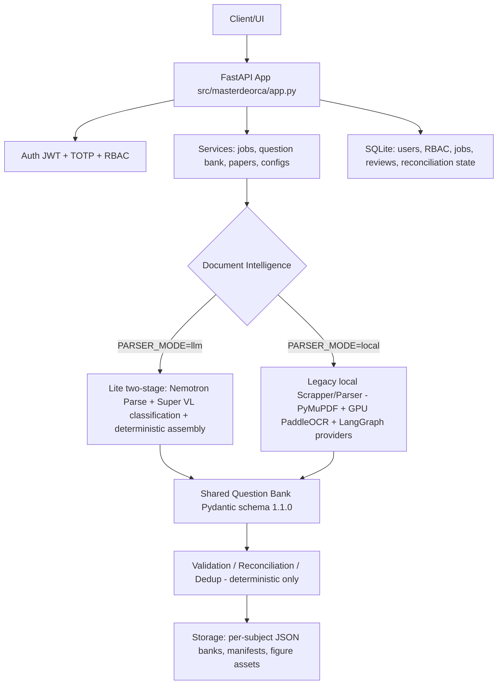
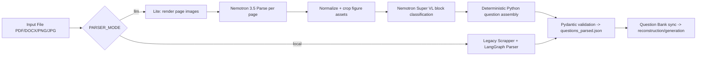

# Architecture

High-level overview. The authoritative, code-verified backend reference —
including the active NVIDIA Lite parser, all API endpoints, persistence
inventory, and the planned Turso transition — is
[BACKEND_ARCHITECTURE.md](BACKEND_ARCHITECTURE.md).

## Overview

## Processing modes

- **Lite mode (`PARSER_MODE=llm`)** is the active NVIDIA parser: no local GPU,
  no OCR, no Scrapper stage. See
  [BACKEND_ARCHITECTURE.md §5](BACKEND_ARCHITECTURE.md#5-active-parsing-pipeline--nvidia-lite-two-stage-parser_modelllm).
- **Local mode (`PARSER_MODE=local`, the settings default)** keeps the legacy
  PyMuPDF/GPU-OCR/LangGraph pipeline operational; it is excluded from the
  active parser description but its code is unchanged.

## Key facts

- Single FastAPI process hosts routes, background jobs, and the reconciliation
  worker thread.
- Persistent Question Banks are per-subject JSON files; administration, jobs,
  RBAC and TOTP state live in SQLite.
- PDFs/figures remain files; only references are stored.
- Localhost is the current development configuration (port 8000, CORS for
  localhost:3000/5173); Turso migration is planned, not implemented.
