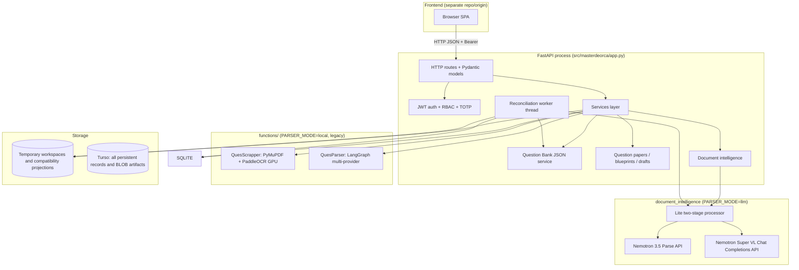
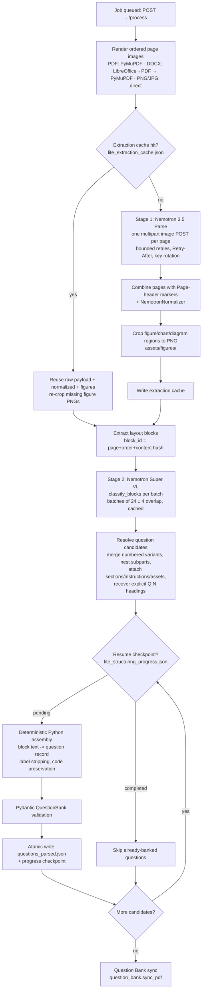
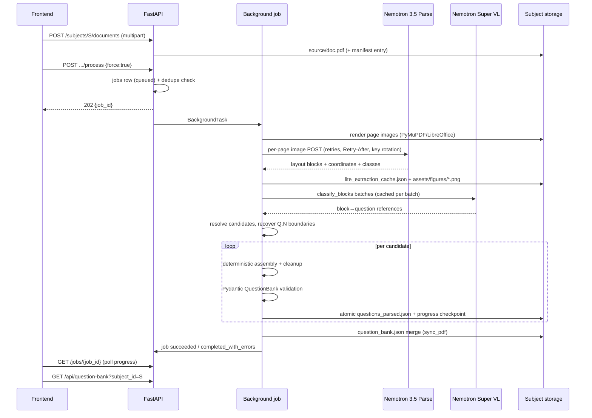

# MasterDeOrca Backend Architecture

> **Current storage status:** Turso Cloud is the only runtime database. All
> Uvicorn, Docker, and deployed instances must use the same authenticated Turso
> URL and token; local SQLite is not a runtime option.

## Current Turso-only runtime

- One FastAPI application uses the configured Turso/libSQL database. Startup
  rejects non-Turso configuration, missing credentials, unavailable connectivity,
  and failed schema migrations; it never creates or switches to a local DB.
- Uploaded documents are stored as `documents.content_blob`; parser outputs,
  extraction caches, figures, tables and reconstruction DOCX assets are stored in
  `stored_artifacts` with checksums and metadata. Generated question-paper DOCX and
  draft DOCX files are stored in BLOB columns.
- Subjects, Question Bank records, priorities, reviews, jobs, processing manifests,
  scheduler state, blueprints, drafts, generated-paper metadata and app
  configurations are database-backed. The frontend continues to use the existing
  FastAPI endpoints and does not receive database paths or BLOB internals.
- Lite processing materializes document/cache files only inside a temporary
  per-operation directory when a library requires paths. Extraction artifacts are
  persisted to Turso; `questions_parsed.json` is persisted only after Pydantic
  validation. Reconciliation is deterministic and operates on the stored parser
  result; it does not call an LLM or re-run paid extraction.
- The legacy Local parser remains in the source but is disabled in the active job
  service. Runtime database access uses only the configured Turso connection.
- `scripts.migrate_data` can copy an existing SQLite database into a new
  destination, then import legacy subject data; `scripts.import_legacy_data`
  imports source documents and parser/output assets into BLOBs without deleting
  original files. `scripts.backup_data`,
  `scripts.restore_backup`, and `scripts.validate_data` cover backup, restore and
  integrity checks.

**Status labels used throughout:**

- **CURRENT IMPLEMENTATION** — exists and runs exactly as described.
- **PLANNED ARCHITECTURE** — agreed direction, not built yet.
- **NOT YET IMPLEMENTED** — described for context only; no code exists.

---

## 1. System overview

MasterDeOrca ("Smart QPG") is a FastAPI backend that turns examination-paper
documents (PDF, DOCX, PNG/JPG) into a validated, editable question bank, and
generates question-paper DOCX files from that bank.

The active processing mode is selected with `PARSER_MODE`:

| Mode | Value | Extraction | Structuring | Status |
|---|---|---|---|---|
| **NVIDIA Lite (active LLM parser)** | `PARSER_MODE=llm` | NVIDIA Nemotron 3.5 Parse (per-page image upload) | NVIDIA Nemotron 3.5 Super VL 120B A12B (block classification) + deterministic Python assembly | **CURRENT IMPLEMENTATION** — the active parser described in §5 |
| **Local** | `PARSER_MODE=local` | Local PyMuPDF scrapper (+ optional GPU PaddleOCR) | Legacy LangGraph multi-provider LLM parser | Retained but disabled for active jobs |

Both modes share one FastAPI application, one auth/RBAC layer, one job system,
one Question Bank JSON format, one reconciliation worker, and one DOCX
reconstruction/generation path.



The frontend is **not** part of this repository. It talks to the backend over
plain HTTP (see §18). No frontend build or static serving exists in the backend.

---

## 2. Repository layout (actual)

```
MasterDeOrca/
├── config/
│   ├── settings.py        # ALL env vars + resolved paths/flags (single source of truth)
│   ├── outputs.py         # stage output dir helpers; pdf_stem sanitization
│   ├── parser.py          # legacy local-parser output/provider config
│   ├── scrapper.py        # legacy batch scraper input config
│   └── reconstruct.py     # legacy reconstructor config
├── functions/             # LEGACY local-mode functional pipelines (unchanged, still used by local mode)
│   ├── QuesScrapper/      # PyMuPDF text/render/figures + PaddleOCR GPU OCR + batch runner
│   ├── QuesParser/        # LangGraph multi-provider parser + shared Pydantic schema (schema.py)
│   └── ReconstructQues/   # questions_parsed.json -> DOCX renderer (used by BOTH modes)
├── src/masterdeorca/
│   ├── app.py             # FastAPI app, ALL routes, request Pydantic models (1958 lines)
│   ├── database.py        # Turso connection + schema helpers (users, jobs, RBAC, TOTP, reconciliation_state)
│   ├── migrations.py      # idempotent startup migrations
│   ├── security.py        # JWT issue/verify, require_user/admin/write deps, subject RBAC
│   ├── storage.py         # subject/document name + path validation, layout helpers
│   ├── processing_manifest.py  # per-subject manifests/processing_status.json
│   ├── services/
│   │   ├── pipeline.py            # job orchestration: lite path + legacy local path + reconstruction
│   │   ├── document_processor.py  # multi-format adapter (PDF/DOCX/PNG/JPG); lite bridge
│   │   ├── question_bank.py       # per-subject question_bank.json CRUD + sync + resources
│   │   ├── question_papers.py     # blueprints, generation, drafts, DOCX, history (JSON files)
│   │   ├── question_priorities.py # global priorities JSON
│   │   ├── basic_config.py        # basic configuration presets JSON
│   │   ├── ui_configurations.py   # UI configuration presets JSON
│   │   └── dashboard_metrics.py   # admin metrics with 10 s in-process cache
│   ├── reconciliation/
│   │   ├── worker.py      # scheduler + recovery/validation/sync pass (deterministic only)
│   │   └── validation.py  # deterministic record assessment (valid/needs_review/invalid/duplicate)
│   ├── functions/totp/    # TOTP service, Fernet crypto, QR rendering, schemas, exceptions
│   └── document_intelligence/
│       ├── lite/          # *** ACTIVE NVIDIA LITE PARSER ***
│       │   ├── two_stage.py      # LiteTwoStageProcessor (1489 lines) — the pipeline core
│       │   ├── structurer.py     # StructureWithLLM: Super VL block classification (+ dormant per-question structure())
│       │   ├── processor.py      # LiteProcessor thin wrapper (dormant utility)
│       │   └── figure_assets.py  # figure/chart/diagram bbox parsing + PNG cropping
│       ├── llm/
│       │   ├── scraper_parser/
│       │   │   ├── nemotron_parse.py      # NemotronParseClient (Stage 1 HTTP)
│       │   │   ├── nemotron_normalizer.py # marker/coordinate/table/math normalization
│       │   │   ├── nemotron_adapter.py    # Nemotron -> legacy QuestionBank adapter (dormant)
│       │   │   ├── structurer.py          # legacy minimal QuestionStructurer (dormant)
│       │   │   └── normalizer.py          # legacy normalizer duplicate (dormant)
│       │   └── clients/nvidia_keys.py     # KeyManager key rotation helper
│       ├── routing/router.py             # DocumentRouter / NemotronOnlyRouter (dormant)
│       ├── pipeline.py                   # DocumentIntelligencePipeline wrapper (dormant)
│       ├── page_images.py                # PDF/DOCX/image -> ordered page images (ACTIVE)
│       ├── interfaces.py, interfaces/    # dataclasses (base.py ACTIVE; interfaces.py unused)
│       └── local/, extraction/, figure_extraction/, normalization/  # EMPTY placeholder packages
├── tests/                 # Parser/Reconstruct/Scrapper (CI), document_intelligence, API/service tests
├── docs/                  # this documentation set
├── pipeline_runner.py     # legacy batch CLI (Scrapper -> Parser -> Reconstruct)
├── compose.yaml           # main service + full/lite profiles
├── compose.gpu.yaml       # GPU overlay
├── Dockerfile / Dockerfile.full / Dockerfile.lite
├── pyproject.toml         # deps; extras: ocr-gpu (PaddleOCR/PaddlePaddle CUDA wheels)
└── .env                   # ACTUAL runtime values (git-ignored; never commit secrets)
```

Empty `__init__.py`-only packages under `document_intelligence/` (`local/`,
`extraction/`, `figure_extraction/`, `normalization/`, `llm/nvidia/`) are
placeholders with no code; they are not part of any active flow.

---

## 3. Startup, lifespan and configuration

### 3.1 Process entry points

- **API server** — `src/masterdeorca/__init__.py::main()` runs
  `uvicorn src.masterdeorca.app:app --host 0.0.0.0 --port <QUES_PORT>` (default 8000).
  Docker uses the same module path in all three Dockerfiles.
- **Application object** — `src/masterdeorca/app.py` creates
  `FastAPI(title="MasterDeOrca API", version="1.0.0", lifespan=lifespan)`.

### 3.2 Lifespan startup (`_startup()`)

1. Validates `QUES_JWT_SECRET`: must be ≥32 characters and must not contain
   "replace" (case-insensitive); otherwise `RuntimeError` at boot.
2. Creates `STORAGE_ROOT` if missing.
3. `database.initialize()` — creates schema in Turso and runs
   `migrations.run_migrations()` over that same configured connection.
4. `database.mark_interrupted_jobs()` — any `queued`/`running` job rows are
   marked `failed` with `stage="interrupted"` and the message
   *"Worker stopped before completion. Start a fresh processing run."*
5. `default_subject()` — ensures the `QUES_DEFAULT_SUBJECT` directory exists.
6. Starts the **reconciliation scheduler** thread (`reconciliation_worker.start_scheduler()`);
   stopped on shutdown.

### 3.3 Configuration loading

`config/settings.py` loads the project-root `.env` via `python-dotenv`
(`override=False`, so real environment variables win) and exposes every setting
as a module attribute. `setting()` strips whitespace. All paths are resolved
relative to `PROJECT_ROOT` (the repo root, i.e. the parent of `config/`).

Key resolved settings:

| Setting | Env var | Default |
|---|---|---|
| `STORAGE_ROOT` | `QUES_STORAGE_ROOT` | `~/.local/share/masterdeorca` (legacy import/CLI compatibility) |
| `DEFAULT_SUBJECT` | `QUES_DEFAULT_SUBJECT` | `OperatingSys` |
| `MAX_UPLOAD_BYTES` | `QUES_MAX_UPLOAD_MB` | `50` (MiB) |
| `API_PORT` | `QUES_PORT` | `8000` |
| `DATABASE_BACKEND` | `DATABASE_BACKEND` | `turso` (required) |
| `TURSO_DATABASE_URL` | `TURSO_DATABASE_URL` | required; database `qp`, org `bibhusharma1` |
| `TURSO_AUTH_TOKEN` | `TURSO_AUTH_TOKEN` | required |
| `JWT_SECRET` / `JWT_TTL_MINUTES` | `QUES_JWT_SECRET` / `QUES_JWT_TTL_MINUTES` | `""` (must be set) / `480` |
| `ADMIN_EMAIL` / `ADMIN_PASSWORD` | `QUES_ADMIN_EMAIL` / `QUES_ADMIN_PASSWORD` | `admin@example.com` / `admin123` |
| `CORS_ORIGINS` | `QUES_CORS_ORIGINS` | `http://localhost:3000,http://127.0.0.1:3000,http://localhost:5173,http://127.0.0.1:5173` |
| `PARSER_MODE` | `PARSER_MODE` | `llm` |
| `NVIDIA_PARSE_MODEL` | `NVIDIA_PARSE_MODEL` | `nvidia/nemotron-3.5-parse` |
| `NVIDIA_STRUCTURE_MODEL` | `NVIDIA_STRUCTURE_MODEL` | `nvidia/nemotron-3.5-super-vl-120b-a12b` |
| `NVIDIA_PARSE_ENDPOINT` | `NVIDIA_PARSE_ENDPOINT` | `https://ai.api.nvidia.com/v1/retrieval/nvidia/nemotron-3.5-parse/parse` |
| `NVIDIA_STRUCTURE_ENDPOINT` | `NVIDIA_STRUCTURE_ENDPOINT` | `https://integrate.api.nvidia.com/v1/chat/completions` |
| `NVIDIA_STRUCTURE_RETRIES` / `_MAX_TOKENS` / `_TIMEOUT` / `_BACKOFF_BASE` | same names | `2` / `4096` / `180` / `1.0` |
| `LITE_STAGE2_BLOCK_BATCH_SIZE` / `LITE_STAGE2_BLOCK_OVERLAP` | same names | `24` / `4` |
| `NVIDIA_API_TIMEOUT` / `NVIDIA_API_RETRIES` / `NVIDIA_API_BACKOFF_BASE` | same names | `300` / `3` / `1.0` |
| `NVIDIA_RENDER_DPI` | `NVIDIA_RENDER_DPI` | `200` |
| `QUES_TOTP_*` | see §15.3 | issuer `Smart QPG`, TTL 5 min, threshold 5, cooldown 120 s |

Current notes:

- `NVIDIA_API_CONCURRENCY` is defined (default 2) but **has no consumer** —
  Lite processing is strictly sequential per document.
- Docker and host Uvicorn instances use the same configured Turso database.
- `DATABASE_BACKEND` must be `turso`; any other value fails at startup and every
  database connection path rejects it.
- `STORAGE_BACKEND=sqlite` is a legacy name for Turso BLOB storage; it does not
  select a local database.
- Reconciliation defaults to 12 hours, supports 24 hours, and does not run
  immediately at startup.
- `QUES_MIN_FREE_VRAM_MB` (default 1500) is read by the legacy GPU runtime
  module for OCR pre-flight checks.
- `QUES_INPUT_DIRS`, `QUES_INPUT_PDFS`, `QUES_MANIFEST_PATH`, `QUES_RECON_*`,
  `QUES_LLM_*`, `QUES_QUESTIONS_OUTPUT` configure only legacy batch CLIs.
- `QUES_VALIDATION_ENABLE_LLM` appears in older docs but is **not implemented
  anywhere** — reconciliation validation is deterministic-only (§13).

### 3.4 Mode dispatch

`PARSER_MODE` (lowercased) is read at call time by:

- `services/pipeline.process_pdf_job` — `llm` → `_run_lite_job(job)`; else legacy local path.
- `services/document_processor.process_document` — `llm` → `LiteProcessor` bridge; else per-format local extraction.
- `document_intelligence/lite/*` — `LiteTwoStageProcessor`/`LiteProcessor` raise `RuntimeError` unless `PARSER_MODE=llm`.
- `app.start_processing` — GPU/OCR pre-flight runs only when mode is **not** `llm`.
- `reconciliation/worker` — lite recovery uses `LiteTwoStageProcessor` directly from the source document.

Docker profiles set the mode: `Dockerfile.full`/`compose` profile `full` →
`PARSER_MODE=local`; `Dockerfile.lite`/profile `lite` → `PARSER_MODE=llm`
(and installs `libreoffice-writer` for DOCX rasterization). The main
`masterdeorca` compose service does **not** set `PARSER_MODE`, so it uses the
`local` default unless the environment provides it.

---

## 4. Storage model (CURRENT IMPLEMENTATION)

### 4.1 Subject directory layout

`STORAGE_ROOT` (default `../CS_MAIN/SUBJECTS`, Docker `/data`) contains one
directory per subject. Subject names must match
`^[A-Za-z0-9][A-Za-z0-9 _-]{0,79}$` (no `.`, `..`, path separators).

```
<STORAGE_ROOT>/
├── <Subject>/
│   ├── source/                      # uploaded original documents (never modified)
│   ├── output/
│   │   ├── Scrapper/<stem>/         # local mode only: pages/, text/, images/, images_vector/, manifest.json, questions_scrapper.json
│   │   └── Parser/<stem>/           # both modes: questions_parsed.json
│   │       └── (lite adds) lite_extraction_cache.json, lite_structuring_progress.json,
│   │           lite_block_classifications.json, assets/figures/*.png
│   ├── output/Reconstruct/<stem>/   # questions_reconstructed.docx
│   ├── manifests/processing_status.json
│   ├── logs/<stem>.log
│   ├── metadata/                    # compatibility output files only
│   └── question_bank.json           # compatibility projection; Turso is canonical
└── .masterdeorca/                   # legacy/local projections; Turso is canonical
    ├── question_paper_blueprints.json
    ├── question_priorities.json
    ├── basic_configurations.json
    ├── ui_configurations.json
    ├── generated_papers/{paper_id}.docx + {paper_id}.json
    └── generated_papers/drafts/{draft_id}.json
```

`pdf_stem()` sanitizes the source filename into a folder name; inputs that are
not plain `.pdf` (DOCX, PNG, …) or contain unsafe characters get an 8-char
SHA-256 suffix (e.g. `paper-1a2b3c4d`), so stage folders never collide.

### 4.2 Turso Cloud (libSQL)

The authenticated URL and token are configured with `TURSO_DATABASE_URL` and
`TURSO_AUTH_TOKEN`. All runtime services and migrations use
`src.masterdeorca.database.connect()`; there is no local application database.
Tables (all created idempotently at startup; `PRAGMA foreign_keys=ON`):

| Table | Purpose |
|---|---|
| `users` | id, email (unique), name, hashed_password (Argon2 via pwdlib), role (`admin`/`teacher`), status (`active`/`approved`/`pending`/`disapproved`), department, created_at, TOTP columns (`totp_secret_encrypted`, `totp_enabled`, `totp_enrolled`, `totp_failed_attempts`, `totp_cooldown_until`, `totp_last_used_step`, `totp_pending_secret_encrypted`) |
| `admins` | email (PK), password_hash, access_mode (`edit`/`readonly`) |
| `teacher_subjects` | teacher_id → subject_name (many-to-many RBAC assignments) |
| `topics` | id, subject_name, name, unit, description; UNIQUE(subject_name, name) |
| `questions` | legacy staging table: subject_name, topic_id, text, difficulty, type, marks, status, source, created_at/updated_at; UNIQUE(source, text) |
| `papers` | legacy table; **not written by the current generation flow** (only `created_by`/`subject_name` updates from teacher deletion/subject rename) |
| `pdf_reviews` | (subject, filename) PK, review_status |
| `jobs` | job_id (PK), subject, filename, status, stage, started_at, updated_at, error, result_json |
| `reconciliation_state` | (subject, filename, stage) PK, status, retry_count, last_error, last_attempt_at, next_retry_at, updated_at |
| `totp_login_challenges` | challenge_token (unique), user_email, expires_at, used, created_at (+ index on user_email) |
| `totp_rate_limits` | created by schema but **unused** by the TOTP service (cooldown is enforced via `users` columns) |

### 4.3 JSON stores

| File | Contents |
|---|---|
| `<subject>/question_bank.json` | `{subject, updated_at, questions:[...]}` — leaf question rows only (parents with subquestions are flattened) |
| `<subject>/manifests/processing_status.json` | `{subject, updated_at, pdfs:[...]}` — per-document status + relative artifact paths |
| `<subject>/metadata/<stem>.processing.json` | last job summary per document |
| `<subject>/metadata/create_idempotency.json` | `{version, keys:{idempotency_key: question_id}}` |
| `.masterdeorca/question_paper_blueprints.json` | `{version:1, blueprints:[...]}`, canonical `default-generic` |
| `.masterdeorca/question_priorities.json` | `{version:1, priorities:{question_id: 1|2|3}}` |
| `.masterdeorca/basic_configurations.json` | `{version:1, configurations:[...]}`, canonical `default-config` |
| `.masterdeorca/ui_configurations.json` | `{items:[...]}` |
| `.masterdeorca/generated_papers/{paper_id}.json` | full generation response record |
| `.masterdeorca/generated_papers/drafts/{draft_id}.json` | draft state |
| `output/Parser/<stem>/lite_extraction_cache.json` | Stage 1 cache (digest + model keyed) |
| `output/Parser/<stem>/lite_structuring_progress.json` | Stage 2 resume checkpoint |
| `output/Parser/<stem>/lite_block_classifications.json` | Stage 2 batch classification cache |

All JSON writes in the services layer are **atomic** (temp file + `fsync` +
`os.replace`, plus directory `fsync` where implemented) and most JSON stores
use a **thread `RLock` + `fcntl.flock`** lock file for cross-process safety.
Corrupt JSON stores are preserved as `*.corrupt-<timestamp>` and rebuilt.

### 4.4 In-memory state (not durable)

`_active_jobs` set (duplicate job prevention), dashboard metrics cache (10 s
TTL), reconciliation `_last_run` summary, Nemotron key rotation index,
`_pipeline_lock` (local mode serialization).

---

## 5. Active parsing pipeline — NVIDIA Lite two-stage (`PARSER_MODE=llm`)

**CURRENT IMPLEMENTATION.** Scope of this section: the only parser the
application runs when `PARSER_MODE=llm`. It lives in
`src/masterdeorca/document_intelligence/` and is invoked by
`src/masterdeorca/services/pipeline.py::_run_lite_job`.

Models used:

- **Stage 1 extraction** — `nvidia/nemotron-3.5-parse`
  (`NVIDIA_PARSE_MODEL`), endpoint `https://ai.api.nvidia.com/v1/retrieval/nvidia/nemotron-3.5-parse/parse`
  (`NVIDIA_PARSE_ENDPOINT`).
- **Stage 2 classification** — `nvidia/nemotron-3.5-super-vl-120b-a12b`
  (`NVIDIA_STRUCTURE_MODEL`), endpoint `https://integrate.api.nvidia.com/v1/chat/completions`
  (`NVIDIA_STRUCTURE_ENDPOINT`), Chat Completions API.



### 5.1 Job trigger and lifecycle

1. `POST /subjects/{subject}/pdfs/{filename}/process` (or `/documents/.../process`)
   validates the document, checks subject access, and — **only in local mode** —
   runs the OCR pre-flight (pages with <20 native-text chars or image inputs
   require `ensure_cuda()`; otherwise HTTP 503). Lite mode needs no local GPU.
2. Guards: latest job `queued`/`running` → 409; already succeeded and
   `force != true` → 409; `(subject, filename)` in the in-memory `_active_jobs`
   set → 409.
3. A `jobs` row is created (`queued`) and the manifest entry updated; the job
   dict is passed to a FastAPI `BackgroundTask` (`_run_job` →
   `process_pdf_job` → `_run_lite_job`).
4. Lite job stages (persisted in `jobs.stage` and the manifest):
   `queued` → `lite_extraction` → `lite_structuring` → `question_bank_sync` →
   `complete`. Final status: `succeeded`, or `completed_with_errors` when one
   or more questions ended as `unstructured`, or `failed` on a hard error.
5. The job `result` carries `parsed_json` path, counts, providers used, and the
   latest progress payload (see §5.10).

Unlike local mode, the Lite path has **no staging directory and no publish/
rollback step**: it writes directly into the final
`output/Parser/<stem>/` folder. Partial results are intentional — a validated
partial bank is always retained (§5.8).

### 5.2 Input preparation — ordered page images

`document_intelligence/page_images.py::render_page_images(path, dpi)` yields
`PageImage(page_number, data, mime, width, height, source_format)` in strict
1-based order:

- **PDF** — PyMuPDF (`fitz`) `get_pixmap` at `NVIDIA_RENDER_DPI` (default 200),
  RGB, no alpha.
- **DOCX** — headless LibreOffice (`soffice --headless --convert-to pdf`,
  300 s timeout) then PyMuPDF rasterization. Missing LibreOffice raises
  `RuntimeError` (the Lite Docker image installs `libreoffice-writer`).
- **PNG/JPG/JPEG** — original bytes passed through as page 1 (PIL used for
  dimensions; multi-frame images are supported by the renderer but uploads
  only accept PNG/JPG/JPEG).

The processor collects all page images into an in-memory
`dict[int, bytes]`; page images themselves are **not** persisted. A page-count
mismatch or non-PNG/JPEG MIME aborts the job.

### 5.3 Stage 1 — Nemotron 3.5 Parse extraction

`llm/scraper_parser/nemotron_parse.py::NemotronParseClient`:

- **Request** — `POST NVIDIA_PARSE_ENDPOINT` with `Authorization: Bearer <key>`,
  multipart field `document` = (`page-NNNNN.png|.jpg`, bytes, mime). Only
  PNG/JPEG page images are accepted (magic-byte validated client-side).
- **Authentication/keys** — key list resolved as `NVIDIA_API` → `NVIDIA_API_KEY`
  → `NVIDIA_API_KEYS` (comma-separated). The parse client **round-robins**
  across all configured keys per request.
- **Retries** — `NVIDIA_API_RETRIES` (default 3) attempts with exponential
  backoff `NVIDIA_API_BACKOFF_BASE * 2^(attempt-1)`. Retried on transport
  errors and HTTP `408/425/429/5xx`; `Retry-After` (seconds or HTTP-date,
  capped at 60 s) overrides the computed delay. Non-retryable statuses raise
  immediately.
- **Response** — JSON with `content` (or `text`). Empty page content raises.
- **Combination** — `combine_pages()` verifies page order and joins pages with
  `<class_Page-header>Page N</class_Page-header>` markers (double newline
  separated).

### 5.4 Normalization and figure asset cropping

- `NemotronNormalizer.normalize()` strips `<x_…><y_…>` coordinate and
  `<class_…>` markers into a clean text view while extracting coordinate lists,
  class lists, LaTeX `table`/`tabular` environments and inline/display math.
- `lite/figure_assets.py::crop_figure_assets()` scans each page's raw Parse
  content for `<class_Figure|Image|Picture|Chart|Graph|Plot|Diagram>` spans with
  nearby coordinate markers, maps them to `figure|graph|diagram`, computes the
  bounding box from the first/last nearby `<x_><y_>` pair, and crops the
  rendered page image to a **PNG** at
  `output/Parser/<stem>/assets/figures/page-NNNNN-<class>-NNN.png`.
  - Writes are atomic (temp + `fsync` + replace).
  - Each asset gets `asset_id = sha256("<digest>:<page>:<class>:<bbox>")[:16]`,
    `asset_type`, `classification`, subject-relative `path`, `source_page`,
    normalized `bbox`, `description`, and `verified: true`.
  - Classes without ≥2 usable coordinates or with empty crops are skipped with
    `LITE_FIGURE_*` log warnings — never invented.

### 5.5 Stage 2 — Nemotron Super VL block classification

`lite/structurer.py::StructureWithLLM.classify_blocks(blocks, figure_assets, batch_id)`:

- **Blocks** — `two_stage._extract_layout_blocks()` parses the Parse marker
  grammar `<x_X1><y_Y1>text<x_X2><y_Y2><class_TYPE>` into blocks with
  `block_id = p{page}-b{reading_order}-{sha256(digest:page:order:text)[:16]}`,
  `layout_type`, `original_text`, cleaned `text`, and per-page
  `figure_asset_ids`. Unmarked text lines become `Unclassified` blocks.
- **Batching** — blocks are sent in batches of
  `LITE_STAGE2_BLOCK_BATCH_SIZE` (default 24, clamped 8–64) with
  `LITE_STAGE2_BLOCK_OVERLAP` (default 4) so questions spanning batch
  boundaries are seen twice; batch identity is a SHA-256 of the sorted block
  IDs.
- **Request** — Chat Completions to `NVIDIA_STRUCTURE_ENDPOINT` with
  `model=NVIDIA_STRUCTURE_MODEL`, `temperature=0`,
  `reasoning_effort="none"`, `max_tokens` clamped from
  `NVIDIA_STRUCTURE_MAX_TOKENS` (default 4096; clamp 1024–131072),
  `response_format={"type":"json_schema", "json_schema":{name:"block_classification", schema:…}}`,
  `stream:false`, timeout clamped 1–600 s from `NVIDIA_STRUCTURE_TIMEOUT`
  (default 180). The prompt asks only for **compact block references**
  (block IDs, asset IDs, question numbers, subpart labels, marks, sections,
  ambiguity flags) — never for reproduced text.
- **Response contract** — `BlockBatchClassification` (Pydantic,
  `extra="forbid"`): `questions[]` (question_number, block_ids,
  sub_questions[], marks, section_name, instruction_block_ids,
  figure_asset_ids, ambiguous_block_ids, ambiguity_note), `sections[]`,
  top-level instruction/other/ambiguous block lists. Every referenced block
  ID and asset ID is checked to exist in the current batch; unknown
  references fail the batch.
- **Retries** — up to `NVIDIA_STRUCTURE_RETRIES` (default 2, clamp 1–3) with
  linear backoff `NVIDIA_STRUCTURE_BACKOFF_BASE * attempt` (base clamped to
  30 s). Transports, HTTP errors, invalid JSON, schema failures and dangling
  references are retryable; the retry prompt includes a **correction note**
  with the validation errors. Final exhaustion raises `RuntimeError` listing
  every attempt.
- **Auth** — `NVIDIA_API` → `NVIDIA_API_KEY` → first of `NVIDIA_API_KEYS`
  (single key; no rotation in this client).
- **Caching** — successful batches are cached in
  `lite_block_classifications.json` (`{version:2, source_sha256, batch_size,
  overlap, batches:{batch_id: classification}}`); cache hits skip the paid
  call.

> **Accuracy note.** The richer per-question `StructureWithLLM.structure()`
> method (one identified question per request, JSON-schema-constrained
> response, truncation correction, asset binding, Pydantic re-validation) is
> fully implemented and unit-tested in the same module, but it is **not
> invoked by the job pipeline** — it is reachable only through the dormant
> `DocumentRouter.process_two_stage` helper (§6). The active Stage 2 is
> batched classification followed by deterministic assembly (§5.6–5.7).

### 5.6 Candidate resolution and boundary recovery

`two_stage._resolve_question_candidates()` merges batch classifications:

- Question numbers are normalized (`Q.2`, `Q2`, `2` → `Q2`); numbered
  subparts `Q2(a)` become the parent `Q2` plus a lettered child.
- Section refs, instruction blocks, figure assets and ambiguous blocks are
  unioned per question; unresolved references are recorded as issues.
- Blocks are sorted by reading order; sub-questions nest recursively by label.
- Orphan ambiguous blocks are attached to the nearest question by reading
  order and flagged.
- `_apply_explicit_question_boundaries()` then scans blocks matching
  `Q. N` / `Q N` / `Q.N(a)` headings and **re-segments** those questions from
  the raw block stream (excluding `page-header`/`page-footer` blocks),
  recovering blocks the classifier omitted and marking recovered/extended
  questions `ambiguous` with explanatory notes.

Candidates are sorted by first block reading order. Zero candidates → job
fails with *"Nemotron Super VL did not identify any question references"*.

### 5.7 Deterministic question assembly and cleanup

Each candidate becomes a record via `_build_question_record()` — **pure
Python, no LLM call**:

- `text`/`original_text` are assembled from the candidate's resolved blocks
  (`_question_content_from_blocks`), preserving paragraph breaks.
- Cleanup (`_clean_block_text` / `_clean_question_content`):
  - strips Parse markers (`<class_…>`, `<x_><y_>`), converts `<br>` to newline;
  - converts `<sub>x</sub>` → `_(x)` and `<sup>x</sup> → `^(x)`; removes
    markdown bold/heading markers — **but never inside code blocks**;
  - strips the printed question-number prefix (`Q.1`, `Question 2:`, `1)`, …)
    and the subpart label (`(a)`, `i.` …) from the first non-code block only,
    keeping labels in metadata fields;
  - `_looks_like_code` (fenced code, `import/def/class/return/if/for/while`,
    assignments) switches the block into preserve-code mode;
  - whitespace is normalized per line, blank runs collapsed; Unicode content
    (e.g. `λ`, `Ω`, `MB`) round-trips unchanged.
- Sub-question records recurse with `sub_id = sha256(parent_id:label)[:16]`,
  `original_question_number = parent + label` (e.g. `Q2(a)`), inherited
  `source_pdf`/pages, and their own `assets`.
- Marks come from the classifier (`marks` string or null; `marks_notation`
  mirrors it). Tables list is empty in Lite records (tables remain in the
  Parse payload text; structured table linking is local-mode behavior).
- `processing_notes` records the provenance: *"Text resolved from cached
  Nemotron Parse block references."*

This is the "placeholder/reference-based extraction" design: Stage 2 output is
only **ID references** (block IDs, asset IDs); the actual wording is resolved
deterministically from the cached Parse blocks, so model verbosity or drift
cannot corrupt question text.

### 5.8 Pydantic validation and unstructured fallback

The shared schema `functions/QuesParser/ParsePipeLIne/schema.py`
(**SCHEMA_VERSION "1.1.0"**) is authoritative for both modes:

- `QuestionBank` — `schema_version`, `metadata: ProcessingMetadata`
  (providers_used, total_pages_processed, total_questions_found,
  total_assets_linked, incomplete_records, …), `questions[]`.
- `QuestionRecord` — stable `question_id`, `original_text`,
  `cleaned_text`, labels/numbers, `marks` (with a `coerce_marks` validator
  that understands `[5]`, `2 x 10`, `0.5+1+0.5`), hierarchy
  (`sub_questions`, `parent_question_ref`), section metadata, source refs,
  `assets: AssetReference[]`, `tables: TableReference[]`, `confidence`,
  `validation_issues`, `review_status`, `processing_notes`.
- `UnstructuredQuestionRecord` — discriminated union member
  (`status="unstructured"`) with `failure_reason` ∈
  `{token_limit, invalid_json, api_error, response_format, schema_validation,
  empty_response, structuring_error}`, `structuring_error` (≤2000 chars),
  `review_status="incomplete"`, `confidence=0.0`.

Per candidate, the assembled record is validated **inside the loop** by
re-validating the whole bank (`QuestionBank.model_validate`). If assembly or
validation raises, the candidate is stored as an `unstructured` record that
preserves the full extracted source text (`_unstructured_source_text`) and
pages, increments `metadata.incomplete_records`, and the job continues —
incomplete model output is **never** appended, and a failed question never
aborts the document.

### 5.9 Atomic persistence, checkpoints and resume

After **every** question (success or unstructured fallback):

- `questions_parsed.json` is rewritten atomically (`_atomic_json_write`:
  NamedTemporaryFile in the same dir + `fsync` + `os.replace`).
- `lite_structuring_progress.json` checkpoint is rewritten atomically:
  `{version:1, source_sha256, candidate_ids, completed:{candidate_id: question_id}}`.

Resume semantics:

- The checkpoint is honored only when `source_sha256` **and** the ordered
  `candidate_ids` match the current run — any change in extraction or
  classification invalidates it.
- A crash after writing the bank but before the checkpoint is healed by
  matching already-present `question_id`s (`existing_ids`).
- Stage 1 reuse: `lite_extraction_cache.json`
  (`{cache_version:1, source_sha256, parse_model, raw_payload, normalized,
  figure_assets}`) is reused only when the digest **and** `NVIDIA_PARSE_MODEL`
  match; missing figure PNGs are re-cropped from re-rendered pages.
- Net effect: retries, reconciliations and resumed jobs never repeat paid
  Nemotron Parse extraction for unchanged inputs, and completed questions are
  never duplicated.

### 5.10 Progress, events and logging

- `on_structuring(page_count)` → job stage `lite_structuring`.
- `on_event(message)` → appended to `<subject>/logs/<stem>.log`
  (render counts, per-page Nemotron request/response lines, structuring start,
  per-question progress lines).
- `on_question_progress(payload)` → persisted in the job `result.progress`:
  `{total_questions, processed_questions, current_question, current_page,
  failed_questions[], completion_percent, status}` — surfaced by
  `GET /jobs/{job_id}` and the per-PDF status endpoint.
- Structured log lines (`LITE_*`, `NEMOTRON_*`, `LITE_STAGE2_*`) carry model,
  question, page, attempt counts, `finish_reason`, token usage and failure
  diagnostics; API keys are never logged.

### 5.11 Question Bank sync

On completion the job calls `question_bank.sync_pdf(subject, filename)`:
the manifest entry must be `succeeded`/`completed_with_errors` with a
subject-contained `result_json` path, then `sync_from_parsed()` flattens the
bank (leaf rows only), filters to validation-`valid` records (all Lite records
lack reconciliation annotations, so they import), and merges into
`<subject>/question_bank.json` under the subject bank lock with idempotent
stable IDs. Note: only the local-mode job path calls `dashboard_metrics.invalidate()`
explicitly; Lite jobs rely on the dashboard cache's 10-second TTL (any later
bank CRUD or subject change also invalidates it).

### 5.12 Caching, retries and error handling summary

| Concern | Mechanism |
|---|---|
| Stage 1 paid extraction | `lite_extraction_cache.json` keyed by file SHA-256 + parse model |
| Stage 2 classification calls | `lite_block_classifications.json` keyed by batch ID + digest |
| Resume after crash | `lite_structuring_progress.json` + bank ID matching |
| Parse HTTP/transport | 3 attempts, exponential backoff, `Retry-After` honored, key round-robin |
| Classification | ≤3 attempts, linear backoff, corrective prompt feedback, dangling-reference rejection |
| Per-question failure | `unstructured` record with preserved text; job continues |
| Whole-document failure | job `failed`, sanitized error (env secrets redacted), manifest/log updated, previous bank untouched |
| Secret hygiene | `NVIDIA_API*` values replaced with `[REDACTED]` in persisted error strings |

### 5.13 What the Lite pipeline does **not** do

- No Scrapper stage, no OCR, no GPU requirement, no LangChain/LangGraph, no
  local LLM providers (Gemini/Groq/Mistral/Cerebras credentials are unused in
  Lite mode).
- No DOCX/PDF output of the parsed bank (reconstruction is a separate,
  explicit request, §8.6).
- No structured table extraction into `tables[]` (local mode only).

---

## 6. `document_intelligence` module inventory (wired vs dormant)

| Module | Status |
|---|---|
| `lite/two_stage.py` (`LiteTwoStageProcessor`) | **ACTIVE** — job pipeline core |
| `lite/structurer.py` (`StructureWithLLM.classify_blocks`) | **ACTIVE** — Stage 2 classification |
| `lite/structurer.py` (`StructureWithLLM.structure`) | Implemented + unit-tested; **dormant** in the job path (per-question LLM structuring; reachable only via `DocumentRouter.process_two_stage`) |
| `lite/figure_assets.py` | **ACTIVE** |
| `lite/processor.py` (`LiteProcessor`) | Thin wrapper used by `document_processor.process_document` (llm branch); `process_to_parsed_json` is a utility |
| `llm/scraper_parser/nemotron_parse.py` | **ACTIVE** — Stage 1 client |
| `llm/scraper_parser/nemotron_normalizer.py` | **ACTIVE** |
| `llm/clients/nvidia_keys.py` (`KeyManager`) | Used only by the dormant legacy `QuestionStructurer`; parse/lite clients select keys inline |
| `llm/scraper_parser/{nemotron_adapter,structurer,normalizer}.py` | Dormant legacy adapters (Nemotron→QuestionBank regex parsing; minimal structurer) |
| `page_images.py` | **ACTIVE** |
| `interfaces/base.py` (`ExtractedDocument`, `DocumentResource`) | **ACTIVE** (shared dataclasses) |
| `interfaces.py` (`Page`, `Figure`, `ExtractedDocument`) | Unused duplicate dataclasses |
| `routing/router.py` (`DocumentRouter`, `NemotronOnlyRouter`), `pipeline.py` (`DocumentIntelligencePipeline`) | Dormant — import-covered by tests only; no route or service calls them |
| `local/`, `extraction/`, `figure_extraction/`, `normalization/`, `llm/nvidia/` | Empty placeholder packages |

---

## 7. Legacy local mode (`PARSER_MODE=local`) — boundary only

**Excluded from the active parser description per scope; code unchanged and
still functional.** Summary for orientation:

- `services/document_processor.process_document` extracts per-format page
  records (PDF via `functions/QuesScrapper` PyMuPDF text/render/figures +
  optional GPU PaddleOCR; DOCX via python-docx; images via OCR) and writes the
  Scrapper manifest + `questions_scrapper.json`.
- `services/pipeline.process_pdf_job` (local branch) runs under a global
  `_pipeline_lock`, stages outputs in a temp work dir under the subject's
  `metadata/`, runs the LangGraph parser
  (`functions/QuesParser/ParsePipeLIne/question_bank.py`) with temporarily
  swapped config globals, validates the parsed JSON, then **publishes atomically
  with backup/rollback** and rewrites temp paths.
- The parser uses LangChain providers (Gemini, Groq, Mistral, NVIDIA, Cerebras)
  with a regex fallback; GPU OCR requires the `ocr-gpu` extra and a real NVIDIA
  GPU (`ensure_cuda()` fails closed — no CPU fallback).
- Reconstruction (`functions/ReconstructQues`) is shared by both modes.

See `parser.md`, `scrapper.md`, `flow.md`, `reconstructor.md` (legacy stage
docs) and `BACKEND_FRONTEND_INTEGRATION.md` (local-mode details).

---

## 8. Subject and document management

### 8.1 Subjects (directory-based)

- Listing (`GET /subjects`) enumerates `STORAGE_ROOT` subdirectories that are
  real dirs, not symlinks, match the name regex, and contain `source/`.
  Administrators see all; teachers see only assigned subjects.
- Create (`POST /subjects`, admin write) builds the full folder layout.
- Rename (`PATCH /subjects/{subject}`) moves the directory and updates
  `topics`, `questions`, `papers`, `jobs`, `pdf_reviews`, `teacher_subjects`
  rows.
- Delete (`DELETE /subjects/{subject}`) refuses while a job is running
  (409), removes the directory tree and all related DB rows.

### 8.2 Upload

`POST /subjects/{subject}/pdfs` (alias `/documents`), multipart field `files`
(repeated). Per file: plain-filename validation (no separators, ≤180 chars,
extension ∈ `.pdf .docx .png .jpg .jpeg`), magic-byte check against the
extension (`%PDF-`, `PK\x03\x04`, PNG/JPEG signatures → else 415), size limit
`QUES_MAX_UPLOAD_MB` (413), no overwrite (409), DOCX must contain `word/` zip
entries (415). Bytes are streamed to a hidden temp file then **hard-linked**
into `source/`. The manifest entry is created as `not_processed`.

### 8.3 Listing, status, result

- `GET /subjects/{subject}/pdfs` — real `source/` files joined with the latest
  job row and manifest; fields include `status`, `job_id`, `question_count`,
  `result_available`, `review_status`, `uploaded_at` (file mtime). Status
  precedence: latest job row, else manifest.
- `GET /subjects/{subject}/processing-status` — the raw per-subject manifest.
- `GET /subjects/{subject}/pdfs/{filename}/status` — job payload or
  `not_processed`.
- `GET .../result?include_questions=true` — parsed bank metadata + optional
  questions; **withheld (409)** unless the latest job succeeded or completed
  with errors.

### 8.4 Review status

`PATCH /subjects/{subject}/pdfs/{filename}` upserts `pdf_reviews.review_status`
(`unreviewed`/`approved`/`disapproved`).

### 8.5 Deletion

`DELETE .../pdfs/{filename}` — refuses while a job runs (409); removes stage
output dirs (Scrapper/Parser/Reconstruct), the source file, `jobs`,
`pdf_reviews`, imported `pyq:` questions, and the manifest entry.

### 8.6 Reconstruction

`POST .../reconstruct` runs `DocumentGenerator`
(`functions/ReconstructQues/generator.py`) over the parsed bank into
`output/Reconstruct/<stem>/questions_reconstructed.docx` — for **both** modes.
It preserves order, labels, marks, sections, source metadata, embeds available
figures/tables, and always appends the accuracy notice + source references.
Missing assets are reported, never guessed. `GET .../reconstruction` downloads
the DOCX. Withheld (409) unless the latest job succeeded.

---

## 9. Question Bank functionality (CURRENT IMPLEMENTATION)

Persistent per-subject bank at `<subject>/question_bank.json`
(`services/question_bank.py`):

- **Flattening** — parsed records are flattened to leaf rows; a parent with
  subquestions is never stored as its own item; children inherit section,
  pages, assets, tables and text defaults.
- **Stable IDs** — parsed records keep their deterministic SHA-based IDs;
  manual/synced rows use UUID5 over `subject/source_pdf/identity`
  (namespace `8f3c2a1e-6d4b-4e5a-9c7f-2b1d0a5e7c33`).
- **Sync** — `sync_pdf()` (post-job) and `sync_from_parsed(protect_edits=True)`
  (reconciliation) merge by `question_id`; existing rows are refreshed in place
  preserving operator fields; `protect_edits` skips rows whose wording no
  longer matches (manual edits are never reverted); exact-signature duplicates
  are refused.
- **Manual CRUD** — `POST /api/question-bank` (required: `subject_id`, text,
  positive integer marks; optional stable `question_id`, `idempotency_key`,
  section/source/page/asset/table metadata, `priority`), `PATCH` (supplied
  fields only; ID/subject immutable), `DELETE`. Retry-safe: same ID + same
  content returns the existing record; conflicting content → 409.
- **Resources** — figure assets resolve only inside the subject directory;
  listing returns lightweight metadata; `GET .../resources/{figure|table}/{id}`
  returns base64 image bytes or structured table JSON on demand.
- **Marks** — `normalize_marks()` returns int/float or null; API list exposes
  `available_marks` (distinct, ascending, pre-filter) and exact `marks`
  matching.
- **Priorities** — separate store (§10); merged into API responses as
  `priority` (default 1).

The bank JSON is the **authoritative** question store for paper generation
and drafts. The SQLite `questions` table is a legacy staging area fed only by
the `/questions/import` endpoint (§15.16).

---

## 10. Question priorities

`{STORAGE_ROOT}/.masterdeorca/question_priorities.json` —
`{version:1, priorities:{question_id: 1|2|3}}`, separate from all banks.
`GET /api/question-priorities` (per-subject IDs or all), `PUT` (1–3),
`DELETE` (reset to 1). Existence is verified against the subject banks
(404 unknown, 403 when the question exists only in unassigned subjects).

---

## 11. Question papers, blueprints, drafts, presets

`services/question_papers.py` + `services/basic_config.py` +
`services/ui_configurations.py`; all persisted as versioned JSON under
`.masterdeorca/` with locks and atomic writes.

- **Blueprints** — CRUD + duplicate; canonical protected `default-generic`
  (`auto_select: true`). Fixed sections require unique names and positive
  `question_count`/`marks_per_question`; stored `total_marks` must equal the
  section sum. Selection: explicit `blueprint_id` → most specific
  subject/exam_type match → default-generic.
- **Generation** (`POST /api/question-papers/generate`) — reads the subject
  bank; `auto_select` uses an exact-sum subset DP over marks (seeded shuffle,
  priority 3→2→1 ordering with random tie-break); fixed sections filter by
  marks and optional question type. Shortages are reported, never fabricated.
  The DOCX is rendered with python-docx, atomically written and verified to
  reopen; the full response is persisted as history JSON.
- **Processing Accuracy Notice** — **always rendered server-side**, exactly
  once, after instructions and before questions, in black text; the
  `include_processing_accuracy_notice` payload field is accepted for API
  compatibility but **cannot disable it** (draft export likewise).
- **Drafts** — created from a fully-satisfiable generation (else 422 with the
  shortfall); editable metadata/sections; add/remove/edit/reorder questions
  with validation (marks must match section marks; sections stay contiguous on
  reorder); `POST .../docx` exports after total-marks validation. Draft edits
  never touch the bank.
- **History** — `GET /api/question-papers/history[/{paper_id}]` (admin: all;
  others: own), `DELETE` owner-or-admin, `GET /api/question-papers/{paper_id}/docx`
  downloads the stored DOCX.
- **Basic configurations** — paper metadata presets (neutral canonical
  `default-config`; subject references must exist; single default flag).
- **UI configurations** — simple named `values` presets for the generate page.

---

## 12. Processing jobs and background tasks

- **Execution** — FastAPI `BackgroundTasks` runs one job per document in the
  API process; `_active_jobs` (in-memory, lock-guarded) prevents duplicates.
- **Persistence** — `jobs` table upserted at every stage transition
  (`database.save_job`); manifest and `metadata/<stem>.processing.json` updated
  in the same `_update()` call; subject log appended.
- **Statuses** — `queued`, `running`, `succeeded`, `completed_with_errors`,
  `failed` (plus `interrupted` stage for restart-killed jobs).
- **Restart safety** — startup marks stranded `queued`/`running` jobs failed;
  Lite checkpoints/caches let a fresh `force=true` run avoid repeating paid
  extraction; reconciliation recovers interrupted documents autonomously.
- **Polling** — `GET /jobs/{job_id}` (admin) or
  `GET /subjects/{s}/pdfs/{f}/status` (subject-access user) return
  `{job_id, subject, filename, status, stage, started_at, updated_at, error,
  result, progress}`.

---

## 13. Reconciliation (CURRENT IMPLEMENTATION)

`src/masterdeorca/reconciliation/` — autonomous recovery hosted **inside the
FastAPI process** (daemon thread started at lifespan; first pass runs
immediately, then every `QUES_RECONCILE_INTERVAL` seconds, clamped 180–300,
default 240).

Responsibilities per pass, per registered subject, per source document:

1. **Skip** documents with an active `queued`/`running` job.
2. **Parse recovery** — parsed JSON missing:
   - local mode: replay the scraped manifest through the legacy parser
     (staged, config-globals swapped);
   - lite mode: locate the source document by stem and run
     `LiteTwoStageProcessor` directly (no Scrapper stage exists).
   Partial leftovers (`.tmp/.partial/.part`) are cleaned.
3. **Deterministic validation** — `validation.assess_question()` classifies
   every record as `valid`, `needs_review`, `invalid` or `duplicate`
   (empty text, numeric/marks fragments, separator lines, OCR noise, question
   signals, finite positive marks). **No LLM calls** — ambiguous records stay
   `needs_review` for a human. Verdicts are persisted as per-record
   `validation` annotations (validator `reconciliation-validator/2`, text
   signature, outcome, timestamp, `duplicate_of`) so unchanged records are
   never re-evaluated or re-sent.
4. **Duplicate marking** — exact normalized-text signature plus
   `difflib` similarity ≥ 0.92, per subject and within the batch; a record
   matching its own imported row is idempotence, not duplication.
5. **Bank sync** — only `valid` records import into `question_bank.json` via
   `sync_from_parsed(protect_edits=True)`; the manifest entry becomes
   `succeeded`.
6. **Retry bookkeeping** — per (subject, filename, stage) rows in the SQLite
   `reconciliation_state` table; bounded retries (parse ≤3, sync ≤5) with
   exponential backoff 120 s → 900 s; exhausted stages stay `failed` until a
   later success clears them.

Concurrency: in-process `threading.Lock` + non-blocking `flock` on
`<STORAGE_ROOT>/reconciliation.lock`; overlapping runs return
`{"skipped": true, "reason": ...}`.

Admin endpoints: `POST /api/reconciliation/run` (edit-mode admin, synchronous
forced pass) and `GET /api/reconciliation/status` (interval, last-run summary,
pending/failed retry states).

> Older documentation (`backend_services.md`) describes an AI review pass with
> LangChain and `QUES_VALIDATION_ENABLE_LLM`. **That pass does not exist in
> the current code** — reconciliation is deterministic-only. The stale text is
> corrected in that file.

---

## 14. Authentication, authorization, TOTP, RBAC

### 14.1 JWT

`security.py` issues HS256 tokens (`sub`=email, `iat`, `exp`; TTL
`QUES_JWT_TTL_MINUTES`, default 480). Dependencies:

- `require_user` — valid token + `users.status ∈ {active, approved}` (DB
  lookup per request; role changes apply without re-login).
- `require_admin` — `role='admin'` (else 403).
- `require_write_user` / `require_admin_write` — additionally refuse
  administrators whose server-side `access_mode` is `readonly` (403).

Tokens carry **no role claims**; all authorization is re-read from SQLite.
No refresh tokens, no logout endpoint (NOT YET IMPLEMENTED).

### 14.2 Subject-level RBAC (teachers)

`teacher_subjects` maps teachers to subject names. `accessible_subjects()`
returns `None` for admins (unrestricted) or the teacher's set. Read routes
filter (`filter_subjects`, `subject_allowed`); write routes on subject-bound
resources (blueprints, basic configurations, question-bank writes, drafts)
enforce `_require_subject_resource_write` — teachers may only mutate resources
for assigned subjects; generic (`subject_id: null`) resources are
administrator-managed.

### 14.3 TOTP 2FA

TOTP lives in `src/masterdeorca/functions/totp/` (service, Fernet crypto, QR
rendering, schemas, exceptions) using `pyotp` + `cryptography.Fernet`
(`QUES_TOTP_ENCRYPTION_KEY`; a Fernet key or any strong passphrase is accepted —
passphrases are SHA-256-derived).

- `POST /auth/totp/enroll` starts enrollment: the secret is **generated once
  and reused** across repeated enroll calls, refreshes and re-enrollment
  confirmation (it never rotates until TOTP is disabled). Re-enrollment while
  enabled requires the current code. Returns `provisioning_uri`,
  `qr_code_payload`, `qr_code_png_base64`; `GET /auth/totp/enroll/qr` returns
  the QR PNG.
- `POST /auth/totp/confirm` activates after a valid code.
- Login is two-stage when enabled: `POST /auth/login` returns
  `{requires_totp, challenge_token}`; `POST /auth/totp/verify` exchanges code +
  challenge for the JWT. Challenge tokens are single-use (atomic claim), TTL
  `QUES_TOTP_CHALLENGE_TTL_MINUTES` (5), capped at 5 live challenges per user.
- Replay protection via matched time-step stored in `totp_last_used_step`;
  failed-attempt counter with cooldown (`QUES_TOTP_FAILED_ATTEMPT_THRESHOLD`
  5, `QUES_TOTP_COOLDOWN_SECONDS` 120) → HTTP 429 + `Retry-After`.
- `GET /auth/totp/status`, `DELETE /auth/totp` (disable keeps the secret).
- The `totp_rate_limits` table exists in the schema but is unused by the
  service.

### 14.4 Admin access modes

`admins.access_mode` (`edit` default / `readonly`). `GET/PUT /auth/access-mode`
(admin only). Read-only administrators keep all read access; every mutating
route returns 403 *"Administrator account is in read-only mode; editing is
disabled"*. Switching back to `edit` is always allowed.

### 14.5 Login

`POST /auth/login` → `database.verify_user()` (Argon2 via pwdlib; constant-ish
work on unknown users). TOTP-disabled accounts receive the JWT directly;
TOTP-enabled accounts get the challenge flow. 401 on bad credentials, 429 in
cooldown.

---

## 15. Complete API endpoint reference

Base URL (development): `http://localhost:8000`. All routes except `/health`
and `POST /auth/login` + `POST /auth/totp/verify` require
`Authorization: Bearer <token>`.

Legend — **A** = any authenticated user (`require_user`); **W** = write-gated
user (`require_write_user`: teachers allowed, readonly admins refused);
**Adm** = admin role; **AdmW** = admin + write gate.

### 15.1 System

| Method | Path | Auth | Description / Response |
|---|---|---|---|
| GET | `/health` | public | Always `200 {"status": "ok"}` (OCR runtime probe runs internally but its result does not change the response; exceptions are swallowed) |

### 15.2 Authentication

| Method | Path | Auth | Body / Query | Response |
|---|---|---|---|---|
| POST | `/auth/login` | public | `{email, password}` | `{access_token, token_type:"bearer"}` or `{requires_totp:true, challenge_token, message}`; 401 bad creds; 429 cooldown |
| GET | `/auth/me` | A | — | user row `{id,email,name,role,status}` + `subjects` (all for admin, assigned for teacher) + `access_mode` for admins |
| GET | `/auth/access-mode` | Adm | — | `{role:"admin", access_mode}` |
| PUT | `/auth/access-mode` | Adm | `{access_mode:"readonly"\|"edit"}` | same shape; 422 invalid value; 409 no admin row |
| POST | `/auth/totp/enroll` | W | optional `{code}` (required when already enabled) | `{provisioning_uri, qr_code_payload, qr_code_png_base64}`; 409 already enabled; 401 bad code; 429 cooldown; 500 TOTP unconfigured |
| GET | `/auth/totp/enroll/qr` | W | — | PNG bytes (`image/png`); 404 not enrolled |
| POST | `/auth/totp/confirm` | W | `{code}` | `{message, totp_enabled:true}`; 400 not started; 401 invalid/replayed code; 429 cooldown |
| POST | `/auth/totp/verify` | public | `{challenge_token, code}` | `{access_token, token_type}`; 401 invalid/expired/reused challenge or code; 400 TOTP not enabled; 429 cooldown |
| GET | `/auth/totp/status` | A | — | `{totp_enabled, enrolled}` |
| DELETE | `/auth/totp` | W | `{code}` | `{message, totp_enabled:false}`; 400 not enabled; 401 bad code; 429 cooldown |

### 15.3 Subjects

| Method | Path | Auth | Body | Response |
|---|---|---|---|---|
| GET | `/subjects` | A | — | `{subjects:[...]}` (filtered for teachers) |
| POST | `/subjects` | AdmW | `{name}` | 201 `{name, created:true, directories:{...}}`; 409 exists; 422 invalid name |
| PATCH | `/subjects/{subject}` | AdmW | `{name}` | `{name, renamed:true}`; renames dir + DB references; 404/409/422 |
| DELETE | `/subjects/{subject}` | AdmW | — | 204; 409 active job; 404 unknown |

### 15.4 Documents (PDFs alias `/pdfs`, documents alias `/documents`)

| Method | Path | Auth | Body / Query | Response |
|---|---|---|---|---|
| GET | `/subjects/{s}/pdfs` | A (+subject access) | — | `{subject, pdfs:[{subject_id, filename, size_bytes, uploaded_at, format, status, job_id, started_at, processed_at, last_error, question_count, result_available, review_status}]}` |
| POST | `/subjects/{s}/pdfs` | W | multipart `files[]` | 201 `{subject, uploaded:[{filename,size_bytes,path}]}`; 400/409/413/415/422 |
| PATCH | `/subjects/{s}/pdfs/{f}` | AdmW | `{review_status}` | `{filename, review_status, size_bytes, status, result_available}` |
| DELETE | `/subjects/{s}/pdfs/{f}` | AdmW | — | 204; 409 active job |
| POST | `/subjects/{s}/pdfs/{f}/process` | W | `{force:true}` (default) | 202 `{job_id, status:"queued", subject, filename}`; 409 active/duplicate/completed-without-force; 503 OCR unavailable (local mode, scanned input) |
| GET | `/subjects/{s}/pdfs/{f}/status` | A (+subject) | — | job payload or `{status:"not_processed"}` |
| GET | `/subjects/{s}/pdfs/{f}/result` | A (+subject) | `include_questions` (bool) | `{subject, filename, parsed_json, question_count, metadata[, questions]}`; 409 when latest job did not succeed |
| GET | `/subjects/{s}/processing-status` | A (+subject) | — | full manifest JSON |

### 15.5 Jobs

| Method | Path | Auth | Response |
|---|---|---|---|
| GET | `/jobs/{job_id}` | Adm | `{job_id, subject, filename, status, stage, started_at, updated_at, error, result, progress}` |

### 15.6 Reconstruction

| Method | Path | Auth | Response |
|---|---|---|---|
| POST | `/subjects/{s}/pdfs/{f}/reconstruct` | W (+subject) | `{docx_path, question_count, subquestion_count, figures_inserted, warnings, missing_assets}`; 409 when latest job did not succeed; 404/422 |
| GET | `/subjects/{s}/pdfs/{f}/reconstruction` | A (+subject) | DOCX `FileResponse`; 404 when absent |

### 15.7 Question Bank (`/api/question-bank`)

| Method | Path | Auth | Params / Body | Response |
|---|---|---|---|---|
| GET | `/api/question-bank` | A | query `subject_id` (required), `marks` (exact, >0), `page` (≥1, default 1), `page_size` (1–200, default 25) | `{items[], pagination{page,page_size,total_items,total_pages}, filters, available_marks[]}`; items carry `priority`, serialized fields, lightweight `resources`, `has_figures`, `has_tables` |
| GET | `/api/question-bank/{qid}` | A | query `subject_id` | full detail + resources |
| GET | `/api/question-bank/{qid}/resources/{figure\|table}/{rid}` | A | query `subject_id` | figure: `{type, metadata, content_base64}`; table: `{type, metadata, content{headers, rows}}` |
| POST | `/api/question-bank` | W | see §9 | 201 saved record; 409 duplicate ID/key conflict; 422 validation; 404 subject |
| PATCH | `/api/question-bank/{qid}` | W | query or body `subject_id`; supplied fields | updated record; 404/422 |
| DELETE | `/api/question-bank/{qid}` | W | query or body `subject_id` | 204; 404 |

### 15.8 Priorities

| Method | Path | Auth | Body / Params | Response |
|---|---|---|---|---|
| GET | `/api/question-priorities` | A | query `subject_id` optional | `{subject_id, default_priority:1, priorities:{qid:p}}` |
| PUT | `/api/question-priorities` | W | `{question_id, priority(1-3), subject_id?}` | `{question_id, subject_id, priority, updated:true}` |
| DELETE | `/api/question-priorities/{qid}` | W | query `subject_id` optional | `{question_id, subject_id, priority:1, reset:bool}` |

### 15.9 Blueprints (`/blueprints` and `/api/question-paper/blueprints` aliases)

| Method | Path | Auth | Body | Response |
|---|---|---|---|---|
| GET | `.../blueprints` | A | — | `{items[], quick_mark_presets:[15,25,50,60,70,80,100]}` (teachers: own-subject or generic only) |
| GET | `.../blueprints/{id}` | A | — | blueprint; 403 unassigned subject |
| POST | `.../blueprints` | W | blueprint object | 201; 409 duplicate id; 422 schema |
| PUT/PATCH | `.../blueprints/{id}` | W | replace / merge | blueprint; 404/422 |
| POST | `.../blueprints/{id}/duplicate` | W | optional `{blueprint_id, name}` | 201 copy (`is_default:false`) |
| DELETE | `.../blueprints/{id}` | W | — | `{blueprint_id, deleted:true}`; default-generic protected (422) |

### 15.10 Question papers

| Method | Path | Auth | Body / Params | Response |
|---|---|---|---|---|
| POST | `/api/question-papers/generate` | W | `QuestionPaperGenerate` (§16) | full paper record incl. `sections`, `shortages`, `seed`, `docx_path`, `docx_url`; 422 blueprint totals/insufficient questions |
| GET | `/api/question-papers/{paper_id}/docx` | A | — | DOCX `FileResponse` |
| GET | `/api/question-papers/history` | A | query `subject`, `page`, `page_size` (≤100) | `{items[], page, page_size, total}` (admin: all; others: own; `docx_available` flag) |
| GET | `/api/question-papers/history/{paper_id}` | A (+owner-or-admin) | — | full stored record |
| DELETE | `/api/question-papers/history/{paper_id}` | W (+owner-or-admin) | — | `{paper_id, deleted:true}` |

### 15.11 Drafts (`/api/question-papers/drafts`)

| Method | Path | Auth | Body | Response |
|---|---|---|---|---|
| POST | `/drafts` or `/drafts/generate` | W | `QuestionPaperGenerate` | 201 draft (creation fails closed on shortages) |
| GET | `/drafts/{draft_id}` | A (+owner-or-admin +subject) | — | draft |
| PATCH | `/drafts/{draft_id}` | W | allowed metadata fields | updated draft |
| POST | `/drafts/{draft_id}/questions` | W | `{question_id, section}` | updated draft |
| PATCH | `/drafts/{draft_id}/questions/{qid}` | W | `{text?, marks?, section?}` | updated draft |
| DELETE | `/drafts/{draft_id}/questions/{qid}` | W | — | updated draft |
| PUT | `/drafts/{draft_id}/question-order` | W | `{question_ids:[...]}` | reordered draft |
| POST | `/drafts/{draft_id}/docx` | A (+owner-or-admin) | optional `{include_processing_accuracy_notice}` (ignored for notice suppression) | DOCX `FileResponse`; 422 until marks total matches |

### 15.12 Basic configurations (`/api/basic-configurations`)

| Method | Path | Auth | Body | Response |
|---|---|---|---|---|
| GET | `/api/basic-configurations` | A | — | `{items[]}` (default first) |
| GET | `/api/basic-configurations/default` | A | — | effective default preset |
| GET | `/api/basic-configurations/{id}` | A | — | preset; 404 |
| POST | `/api/basic-configurations` | W | preset fields (server owns id/timestamps/is_default) | 201 |
| PUT | `/api/basic-configurations/{id}` | W | full replace of user fields | preset; 404 |
| PATCH | `/api/basic-configurations/{id}` | W | merge fields | preset; 404/422 |
| POST | `/api/basic-configurations/{id}/duplicate` | W | optional `{name}` | 201 copy |
| POST | `/api/basic-configurations/{id}/set-default` | W | — | updated store (single default) |
| DELETE | `/api/basic-configurations/{id}` | W | — | `{configuration_id, deleted:true}`; canonical default re-established |

### 15.13 UI configurations (`/api/ui-configurations`)

| Method | Path | Auth | Body | Response |
|---|---|---|---|---|
| GET | `/api/ui-configurations` | A | — | `{items[]}` |
| GET | `/api/ui-configurations/{id}` | A | — | item; 404 |
| POST | `/api/ui-configurations` | W | `{name?, values?, is_default?}` | 201 item |
| PATCH | `/api/ui-configurations/{id}` | W | fields | item; 404/422 |
| DELETE | `/api/ui-configurations/{id}` | W | — | 204; 404 |

### 15.14 Dashboard & reconciliation (admin)

| Method | Path | Auth | Response |
|---|---|---|---|
| GET | `/api/dashboard/metrics` | Adm | `{total_teachers, total_subjects, total_questions, availability{...}, unavailable_subjects[], cached, cache_ttl_seconds}` |
| POST | `/api/reconciliation/run` | AdmW | synchronous forced pass summary `{subjects, per_subject, totals}` or `{skipped:true, reason}` |
| GET | `/api/reconciliation/status` | Adm | `{interval_seconds, last_run, pending[]}` |

### 15.15 Teachers (`/teachers`)

| Method | Path | Auth | Body / Params | Response |
|---|---|---|---|---|
| GET | `/teachers` | Adm | query `status`, `search`, `page`, `page_size` (≤200) | `{teachers[], total}` (includes `subject_count`, `subjects`) |
| POST | `/teachers` | AdmW | `TeacherCreate` (password optional → generated, never returned) | 201 teacher; 409 email exists |
| PATCH | `/teachers/{id}` | AdmW | allowed fields incl. `subjects` (replace set) | teacher; 404/409/422 |
| DELETE | `/teachers/{id}` | AdmW | — | 204 (papers.created_by nulled first) |
| GET | `/teachers/{id}/subjects` | Adm | — | `{teacher_id, subjects[]}` |
| POST | `/teachers/{id}/subjects` | AdmW | `{subjects[]}` replace or `{subject}` add | `{teacher_id, subjects[]}` |
| DELETE | `/teachers/{id}/subjects/{subject}` | AdmW | — | 204; 404 |

### 15.16 Legacy DB questions/topics/papers/analytics

| Method | Path | Auth | Description |
|---|---|---|---|
| GET | `/questions` | A | SQLite `questions` list; filters `subject`, `status`, `difficulty`, `search`, `page`, `page_size`; teachers restricted to assigned subjects |
| POST | `/questions` | AdmW | create legacy row (`QuestionCreate`) |
| PATCH | `/questions/{id}` | AdmW | update allowed fields |
| DELETE | `/questions/{id}` | AdmW | 204 delete |
| POST | `/subjects/{s}/pdfs/{f}/questions/import` | AdmW | `{overwrite?}` — flatten parsed bank into SQLite `questions` (origin `pyq:<filename>`, MEDIUM/LONG, marks clamped 1–100); 409 when already imported without overwrite; returns `{imported, skipped_duplicates, questions[]}` |
| GET | `/subjects/{s}/topics` | A (+subject) | topics with `question_count` |
| POST | `/subjects/{s}/topics` | AdmW | `TopicCreate`; 409 duplicate name |
| PATCH | `/topics/{id}` | AdmW | `name`, `unit`, `description` |
| DELETE | `/topics/{id}` | AdmW | 204 |
| GET | `/papers` | A | legacy `papers` table list (non-admin or `created_by=me` → own papers only); **not populated by the current generation flow** |
| GET | `/subjects/{s}/weightage` | A (+subject) | topic frequency analytics from legacy SQLite: `{subject, papers_analyzed, topics:[{topic_id, topic_name, frequency, papers_count, historical_marks, last_appeared, weight_score, tier}]}` |

### 15.17 Custom error contract

`RequestValidationError` on `/api/question-papers/generate`, `/drafts` and
`/drafts/generate` returns
`{"detail": "Question paper request is invalid.", "errors": [{field, message}]}`
(with `title` aliased to `paper_title`); all other routes keep FastAPI's
default 422 shape.

---

## 16. Request/response schemas (Pydantic, `app.py`)

- `LoginRequest` — email (3–254), password (1–256).
- `SubjectRequest` — name (1–80).
- `ProcessRequest` — `force: bool = True`.
- `TeacherCreate` — name (≤120), email, department (≤64), password (≥8,
  optional), status (`pending` default), subjects list.
- `TeacherSubjectAssign` — `subjects[]` (replace) or `subject` (add one).
- `QuestionCreate` — subject, topic_id?, text (≤2000), difficulty, type,
  marks (1–100).
- `TopicCreate` — name (≤120), unit ≥1?, description?.
- `QuestionPriorityUpdate` — question_id, priority StrictInt 1–3, subject_id?.
- `QuestionPaperGenerate` — `title` (alias `paper_title`), subject, exam_type,
  total_marks (StrictInt 1–1000), duration, blueprint_id?, seed?,
  institutional metadata (university/college/department names, academic_year,
  semester, subject_name, subject_code, examination_date),
  `include_processing_accuracy_notice` (accepted, **ignored** — the notice is
  always rendered). Validators strip whitespace and reject blank strings.
- `DraftDocxExport` — `include_processing_accuracy_notice?` (same ignore rule
  at the service layer: the exported DOCX always contains the notice).
- `BasicConfigurationUpsert` / `BasicConfigurationPatch` — preset fields with
  length limits; `configuration_id`, `is_default`, timestamps are server-owned.

Lite job result payload (from `_run_lite_job`):
`{source_pdf, parsed_json, mode:"llm", question_count,
structured_question_count, unstructured_question_count,
extraction_provider:"nvidia_nemotron", structuring_provider:"nvidia_nemotron_super_vl",
progress, question_bank_items}`.

---

## 17. End-to-end data flow (Lite mode)



Numbered walkthrough:

1. Admin uploads a document → `source/` (hard-linked, magic-byte validated).
2. Process request creates the job; background task runs the Lite pipeline.
3. Stage 1 renders page images and uploads them one by one to Nemotron Parse;
   results are normalized, combined in page order, cached, and figure regions
   are cropped to PNGs.
4. Stage 2 classifies layout blocks in overlapping batches via Super VL,
   resolves question candidates, recovers explicit headings, and assembles
   records deterministically.
5. Each validated question is appended to `questions_parsed.json` atomically
   with a resume checkpoint; failures become `unstructured` records.
6. On completion the parsed bank merges into the subject Question Bank.
7. The frontend polls job status, browses the bank, fetches figures/tables on
   demand, and can reconstruct a DOCX or generate papers/drafts.

---

## 18. Frontend communication (localhost development)

- **Base URL** `http://localhost:8000`; interactive docs at `/docs`.
- **Auth** — `POST /auth/login` → `access_token`; send
  `Authorization: Bearer <token>` on every other call. TOTP-enabled accounts
  complete `POST /auth/totp/verify` with the login `challenge_token`.
- **CORS** — `CORSMiddleware` with `allow_credentials=True`; methods
  GET/POST/PUT/PATCH/DELETE/OPTIONS; headers `Authorization`,
  `Content-Type`, `Accept`, `Accept-Language`, `Content-Language`. Allowed
  origins come from `QUES_CORS_ORIGINS` (env overrides the settings default):
  `http://localhost:3000`, `http://127.0.0.1:3000`, `http://localhost:5173`,
  `http://127.0.0.1:5173`. `localhost` and `127.0.0.1` are distinct origins —
  keep the frontend's exact origin listed.
- **Content types** — JSON bodies; `multipart/form-data` for uploads (field
  `files`); DOCX downloads are `application/vnd.openxmlformats-officedocument.wordprocessingml.document`;
  TOTP QR is `image/png`.
- **Polling** — job progress via `GET /jobs/{job_id}` (fields `status`, `stage`,
  `result.progress` with `completion_percent`) or the per-PDF status endpoint.
- **Feature → endpoint map** (all verified against `app.py`):
  login/me/access-mode/TOTP (§15.2); subject CRUD + PDF upload/list/review/
  delete/process/status/result (§15.3–15.5); reconstruction (§15.6); bank
  browse/filter/paginate + lazy figure/table loading + manual CRUD (§15.7);
  priorities (§15.8); blueprints (§15.9); generate + history + DOCX download
  (§15.10); drafts (§15.11); basic/UI presets (§15.12–15.13); dashboard +
  reconciliation controls (§15.14); teacher admin (§15.15); legacy questions/
  topics/import/weightage (§15.16).
- The frontend repository is separate; this backend defines the contract.
  `for_ui_developers.md` remains the UI-focused companion guide.

---

## 19. Error handling conventions

- `HTTPException` with `detail` (string or object); business conflicts 409
  (existing subject/document, duplicate IDs, active job, completed-without-force,
  already imported); validation 422 (including the custom paper-route shape);
  not-found 404; auth 401; RBAC 403; upload 400/413/415; OCR-unavailable 503
  (local mode only).
- Job failures store a sanitized message (environment values containing
  `API_KEY`/`SECRET`/`PASSWORD` are replaced with `[REDACTED]`); details go to
  the subject log.
- JSON stores: unreadable/corrupt files are archived as `*.corrupt-<ts>` and
  rebuilt; per-file errors never fail an entire listing.
- Empty results are successful 200 responses with empty arrays/zero totals —
  never errors.

---

## 20. Persistence inventory

`TURSO_DATABASE_URL` and `TURSO_AUTH_TOKEN` configure the shared Turso Cloud
database (`qp`, organization `bibhusharma1`). `QUES_STORAGE_ROOT` is used only
for temporary workspaces, compatibility projections, and explicit local exports.

| Data | Location | Format |
|---|---|---|
| Users, teachers, permissions, subjects, legacy questions/papers, reviews, jobs, TOTP and reconciliation | Turso relational tables | shared application database |
| Question Bank records | Turso `question_bank_records` | JSON per row, indexed and ordered; runtime source of truth |
| Blueprints, priorities, basic configs, UI configs, drafts and generated papers | Turso tables and BLOB columns | canonical structured records and document bytes |
| Processing status and manifests | Turso `processing_manifests`, `jobs`, `processing_logs` | runtime reads and writes use database records |
| Uploaded documents and parser/generated artifacts | Turso `documents` and `stored_artifacts` BLOBs | local copies materialized only as needed for processing/download |
| Temporary stage files | per-operation temporary directories; legacy CLI output paths | ephemeral work files, never an application database |
| In-memory job dedupe, metrics cache, scheduler state | process RAM | — |

### 20.1 Turso runtime storage

Turso is the required runtime database. Versioned migrations and all application
CRUD use the same authenticated connection. Local SQLite tools are for explicit
offline import/backup workflows only and are not reachable from application
services. Local temporary processing files and compatibility projections may
exist, but runtime reads use Turso records and artifacts.

---

## 21. Localhost development configuration

- Backend: `uvicorn src.masterdeorca.app:app --reload --host 0.0.0.0 --port 8000`
  or `python -m src.masterdeorca` (`QUES_PORT`). Docker: compose maps
  `${QUES_PORT:-8000}:8000`, container `PaperWise`, healthcheck hits
  `/health`.
- Storage: `/data` (`QUES_STORAGE_ROOT=/data`) may hold temporary files and
  compatibility projections; application persistence uses the shared Turso DB.
  `metadata/` folder.
- Frontend origins: `http://localhost:3000`, `http://127.0.0.1:3000`,
  `http://localhost:5173`, `http://127.0.0.1:5173` (Vite/Next dev servers).
- NVIDIA API traffic goes directly from the backend to
  `ai.api.nvidia.com` (Parse) and `integrate.api.nvidia.com` (Chat Completions)
  — no proxy in localhost development.
- `.env` holds all secrets (JWT secret, TOTP encryption key, NVIDIA keys);
  `.env.example` is the committed template. **Never commit `.env`.**
- **Cloud transition (PLANNED, gradual):** localhost remains the development
  configuration; persistent data moves to Turso (§20.1), documents/figures to
  persistent object storage or volume-backed paths, and the same API contract
  is served from deployed containers. Until then, every endpoint, port and
  CORS origin above stays operational.

---

## 22. External service dependencies

| Dependency | Used by | Notes |
|---|---|---|
| NVIDIA Nemotron 3.5 Parse API | Lite Stage 1 | `NVIDIA_API`/`NVIDIA_API_KEY`/`NVIDIA_API_KEYS`; multipart image upload |
| NVIDIA Nemotron 3.5 Super VL 120B A12B (Chat Completions) | Lite Stage 2 | `response_format: json_schema`; local Pydantic validation remains authoritative |
| LibreOffice (`soffice`) | Lite DOCX rasterization | required in Lite images (installed in `Dockerfile.lite`) |
| PyMuPDF (`fitz`) | page rendering (both modes), native text (local) | CPU |
| PaddleOCR/PaddlePaddle GPU | local-mode OCR only | optional `ocr-gpu` extra; fails closed without NVIDIA GPU |
| LangChain providers (Gemini/Groq/Mistral/NVIDIA/Cerebras) | legacy local parser only | unused in Lite mode |
| Turso/libSQL | All persistent application records and BLOB artifacts | Required runtime store; startup migrations and CRUD use the authenticated configured connection (§20.1) |

Python deps of record: FastAPI, uvicorn, python-multipart, python-dotenv,
pydantic v2, PyMuPDF, Pillow, python-docx, langchain*, pwdlib[argon2], PyJWT,
pyotp, cryptography, qrcode, httpx (direct NVIDIA calls).

---

## 23. Testing and CI (verified)

- CI (`.github/workflows/tests.yml`): `uv run pytest tests/Parser
  tests/Reconstruct tests/Scrapper` on push/PR — **80 passed** in this tree.
- `tests/document_intelligence/` (not in CI): Lite unit tests cover page-order
  combining, empty/failure propagation, extraction-cache reuse across
  structuring retries, batch retry from cache, resume without duplication,
  explicit heading boundary recovery, deterministic text cleanup, figure
  cropping, Super VL request shape (json_schema, temperature 0,
  reasoning_effort none, key redaction), and truncation/refusal/tool-call
  rejection.
- Full local run: **231 passed, 2 failed, 1 skipped**. The 2 failures
  (`tests/document_intelligence/test_lite_process_execution.py`) are stale
  integration tests written for the earlier per-question structuring flow; the
  current pipeline uses batched classification + deterministic assembly
  (covered by the passing `test_lite_two_stage.py`). The 1 skip is a DOCX
  rasterization test requiring LibreOffice. `tests/Scrapper/test_hardware_gpu.py`
  is hardware-marked.
- `tests/test_api.py` etc. cover auth, subjects, uploads, jobs, banks, papers,
  reconciliation and dashboard behavior via `TestClient`.

---

## 24. Documentation map

| Document | Coverage |
|---|---|
| `docs/BACKEND_ARCHITECTURE.md` (this file) | authoritative backend reference |
| `docs/ARCHITECTURE.md` | high-level overview + mode diagram |
| `docs/API.md` | endpoint index |
| `docs/PIPELINE.md` | pipeline stages incl. Lite details |
| `docs/CONFIGURATION.md` | env vars + NVIDIA key rotation |
| `docs/DOCKER.md`, `docs/TROUBLESHOOTING.md`, `docs/LIMITATIONS.md`, `docs/admin-workflows.md` | deployment, ops, accuracy limits, admin workflows |
| `BACKEND_FRONTEND_INTEGRATION.md` | legacy local-mode integration detail (historical) |
| `backend_services.md` | service-level contracts (reconciliation section corrected to deterministic-only) |
| `for_ui_developers.md` | frontend contract companion |
| `flow.md`, `parser.md`, `scrapper.md`, `reconstructor.md` | stage docs (Lite notes added) |

---

## Appendix A. Nemotron Parse block marker grammar

Parse page content interleaves text with markers:

```
<x_{x1}><y_{y1}> …text… <x_{x2}><y_{y2}><class_{LayoutType}>
```

- `<class_Page-header>Page N</class_Page-header>` — injected per page by
  `combine_pages()`; also used by the normalizer for page attribution.
- Layout classes include `Figure`, `Image`, `Picture`, `Chart`, `Graph`,
  `Plot`, `Diagram`, `Table`, `Text`, `Code`, `Page-header`, `Page-footer`,
  `Section-header`, `Unclassified` (fallback).
- Figure classes map to asset types: figure/image/picture → `figure`;
  chart/graph/plot → `graph`; diagram → `diagram`.

## Appendix B. Question record fields (schema 1.1.0)

`question_id`, `status` (`structured`|`unstructured`), `original_text`,
`cleaned_text`, `original_label`, `original_question_number`,
`parent_question_ref`, `marks`, `marks_notation`, `marks_components`,
`marks_notation_preserved`, `sub_questions[]` (recursive: `sub_id`, labels,
text, marks, assets, tables, pages), `section_name`, `section_instructions`,
`is_compulsory`, `source_pdf`, `source_pages[]`, `assets[]`
(`asset_id`, `asset_type`, `path`, `source_page`, `description`, `verified`),
`tables[]` (`table_id`, `headers`, `rows`, `cells`, `source_page`, `bbox`,
`extraction_method`), `confidence`, `validation_issues[]`, `review_status`
(`pending`|`approved`|`flagged`|`incomplete`), `processing_notes[]`;
unstructured records add `failure_reason` and `structuring_error`.
Top-level bank adds `schema_version`, `metadata` (incl. `providers_used`,
totals, `incomplete_records`) and a computed `marks_index` view.

## Appendix C. Enumerations

- Job `status`: `queued`, `running`, `succeeded`, `completed_with_errors`,
  `failed`. Job `stage`: `queued`, `lite_extraction`, `lite_structuring`,
  `question_bank_sync`, `complete` (lite); `queued`, `scraping`, `parsing`,
  `publishing`, `question_bank_sync`, `complete` (local); `interrupted`
  (restart-killed).
- Document review: `unreviewed`, `approved`, `disapproved`.
- Priority: `1` regular, `2` higher, `3` must-come.
- Reconciliation outcomes: `valid`, `needs_review`, `invalid`, `duplicate`.
- Admin access mode: `edit`, `readonly`. Teacher status: `pending`,
  `approved`, `disapproved`. User status: `active`, `approved` (login-eligible).
