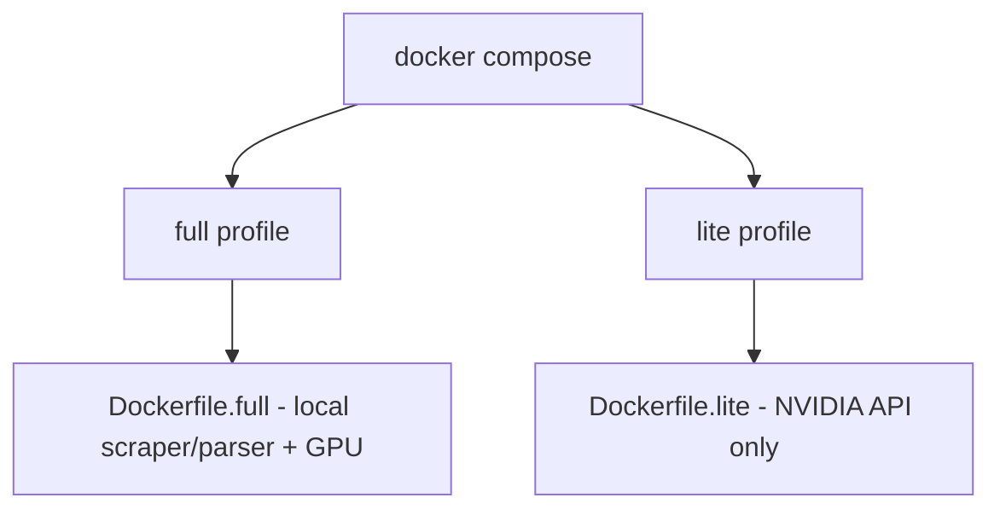

# Docker

## Profiles


## Build/Run
- Full: `docker compose --profile full build && docker compose --profile full up -d`
- Lite: `docker compose --profile lite build && docker compose --profile lite up -d`
- Logs: `docker compose logs -f`
- Stop: `docker compose down`


## Exact Commands
**Full (Local):**
```bash
docker compose --profile full build
docker compose --profile full up -d
```

**Lite (NVIDIA API):**
```bash
docker compose --profile lite build
docker compose --profile lite up -d
```

The Lite image includes LibreOffice Writer for converting DOCX pages before
Nemotron extraction. PDF pages are rasterized by PyMuPDF.

Stop: `docker compose down` | Logs: `docker compose logs -f` | Health: `curl http://localhost:8000/health`
