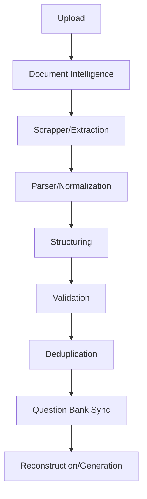

# Pipeline

Scraper → Parser → Structuring → Question Bank. Local mode uses existing behavior; LLM (Lite) mode uses the two-stage NVIDIA pipeline without a Scrapper stage and without double-parsing.

## Lite mode (`PARSER_MODE=llm`) — CURRENT IMPLEMENTATION

Lite mode prepares ordered page images from PDFs, DOCX files, and supported
images. DOCX conversion uses headless LibreOffice; PDF rasterization uses
PyMuPDF. Original PNG/JPEG files are sent directly. Each page is submitted
sequentially to NVIDIA Nemotron 3.5 Parse, with bounded retries and
`Retry-After` handling. Parse output retains page order, semantic classes,
coordinates, tables, equations and text. Figure, chart and diagram classes
with usable normalized bounding boxes are cropped from their source page and
saved as PNGs under the document's `assets/figures/` directory. Parse results
and crops are cached by source-file digest and parser model
(`lite_extraction_cache.json`), so structuring retries and resumed jobs do not
repeat paid extraction.

Stage 2 first segments the ordered extracted pages into layout blocks
(`block_id` per block, page-anchored, with per-page figure asset references).
Blocks are classified in batches
(`LITE_STAGE2_BLOCK_BATCH_SIZE`, default 2, overlap 0) by Mistral Large 4
(`mistralai/mistral-large-4-1t-a52b`) hosted through NVIDIA Chat Completions
(`classify_blocks`), with bounded concurrency (`LITE_STAGE2_CONCURRENCY`, default 3).
Reasoning is disabled for this reference-classification request and the configurable
completion budget defaults to 8,192 tokens; responses ending at the token limit are
split into smaller batches before they can be accepted.
Each batch
request asks only for compact **references** — block IDs, asset IDs, question
numbers, subpart labels, marks, sections, ambiguity flags — constrained by a
`BlockBatchClassification` Pydantic schema; referenced IDs are validated
against the batch before a classification is accepted or cached
(`lite_block_classifications.json`). Bounded retries include corrective
feedback; transient API failures use bounded retries.

The classified references are then resolved deterministically in Python:
questions are merged by normalized number, subparts nested, sections and
instructions attached, ambiguous blocks assigned to the nearest question, and
explicit `Q. N` headings re-segment question boundaries from the raw block
stream. Each question record is assembled from its referenced blocks' text
(placeholder/reference-based extraction) with deterministic cleanup — printed
question-number and subpart labels are stripped into metadata fields, code
blocks are preserved verbatim, and OCR whitespace/markup is normalized.

Every assembled record is validated against the shared Question Bank Pydantic
schema (version 1.1.0) before it is appended. After each validated question,
`questions_parsed.json` is atomically updated. The adjacent
`lite_structuring_progress.json` checkpoint is bound to the source-file digest
and the identified candidate list, so a failed or interrupted job resumes
without repeating completed questions or Nemotron Parse extraction. A question
whose assembly or validation fails is stored as an `unstructured` record that
preserves its extracted source text; incomplete model output is never
appended. Job status reports total, processed, current and failed questions
with completion percentage. The existing Question Bank sync imports the
completed bank.

NVIDIA authentication uses `NVIDIA_API`; `NVIDIA_API_KEY` and
`NVIDIA_API_KEYS` remain accepted for backward compatibility. The parse client
round-robins all configured keys; structuring uses the first configured key.
`NVIDIA_STRUCTURE_MODEL`, `NVIDIA_STRUCTURE_ENDPOINT`,
`NVIDIA_STRUCTURE_RETRIES` and `NVIDIA_STRUCTURE_TIMEOUT` configure the second
stage separately from Parse. Reconciliation applies deterministic Python/JSON
validation only; ambiguous records remain marked `needs_review` for a human and
do not trigger LLM calls.

> Note: `StructureWithLLM.structure()` — one identified question per request
> with JSON-schema-constrained output — is implemented and unit-tested in
> `document_intelligence/lite/structurer.py`, but the active job pipeline uses
> batched `classify_blocks` plus the deterministic assembly described above.
> `structure()` is not invoked by any route or service.

Model references:

- [Nemotron 3.5 Parse](https://build.nvidia.com/nvidia/nemotron-3.5-parse)
- [Mistral Large 4](https://build.nvidia.com/mistralai/mistral-large-4-1t-a52b)
- [NVIDIA NIM Chat Completions API](https://docs.nvidia.com/nim/large-language-models/latest/reference/api-reference.html)

## Local mode (`PARSER_MODE=local`) — legacy

Local mode keeps the existing Scrapper → Parser behavior (PyMuPDF extraction,
optional GPU PaddleOCR, LangGraph multi-provider parsing with regex fallback,
staged publish with rollback). It is unchanged and operational; see
`parser.md`, `scrapper.md` and `BACKEND_FRONTEND_INTEGRATION.md`.
