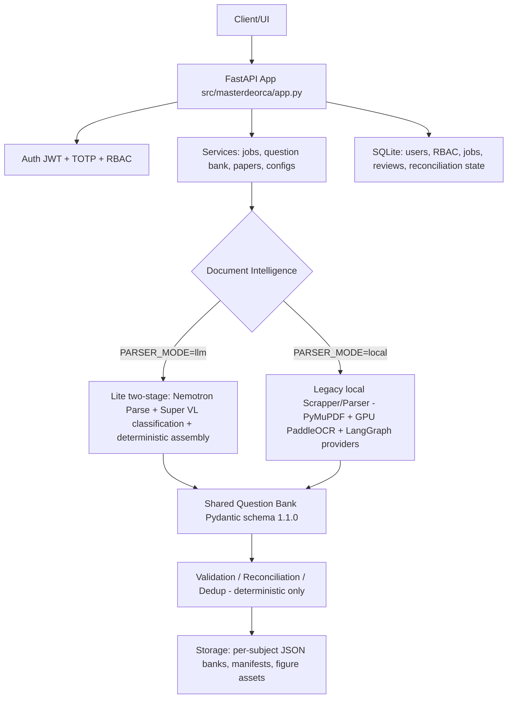
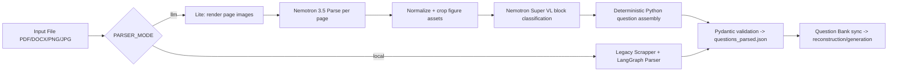

# Architecture

MasterDeOrca ("Smart QPG") is a FastAPI backend that turns examination-paper
documents (PDF, DOCX, PNG, JPG/JPEG) into a validated, editable question bank and
generates question-paper DOCX files from that bank.

## Overview

## Processing modes

- **Lite mode (`PARSER_MODE=llm`)** is the active NVIDIA parser: no local GPU,
  no OCR, no Scrapper stage. See [document-processing.md](document-processing.md)
  and [ai-models.md](ai-models.md).
- **Local mode (`PARSER_MODE=local`)** keeps the legacy PyMuPDF/GPU-OCR/LangGraph
  pipeline operational; its code is unchanged but it is not the active parser.

## Key facts

- Single FastAPI process hosts routes, background jobs, and the reconciliation
  worker thread.
- Persistent Question Banks are per-subject JSON files; administration, jobs, RBAC
  and TOTP state live in SQLite.
- PDFs/figures remain files; only references are stored in the bank.
- Localhost is the current development configuration (port 8000, CORS for
  localhost:3000/5173); Turso migration is planned, not implemented.

## Glossary

- **Frontend** — screens users work with; talks to backend via APIs.
- **Backend** — FastAPI app handling requests, permissions, processing, storage.
- **API** — connects frontend and backend.
- **SQLite** — application database (single source of truth).
- **BLOB** — file bytes stored inside the database.
- **Scrapper** — collects text, pages, images (legacy local mode).
- **Parser** — organises content into questions.
- **OCR** — reads text from images.
- **Question Bank** — collection of organised questions.
- **Blueprint** — rules for arranging a question paper.
- **Job** — tracks a task that takes time.

## Deep reference

The full code-verified backend reference (all endpoints, persistence inventory,
Turso notes) is [BACKEND_ARCHITECTURE.md](BACKEND_ARCHITECTURE.md).
Related: [backend-structure.md](backend-structure.md), [api-reference.md](api-reference.md),
[database.md](database.md), [complete-workflow.md](complete-workflow.md).
