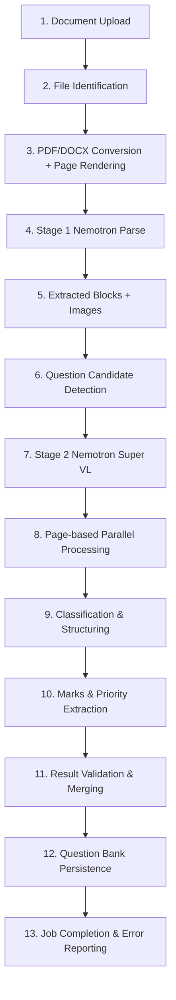

# Complete Workflow: Upload to Saved Questions

End-to-end journey from document upload to persisted Question Bank records (Lite mode,
`PARSER_MODE=llm`, the active parser). Optional/conditional steps are marked.

## 1. Document upload

`POST /subjects/{subject}/pdfs` (alias `/documents`), multipart `files[]`. Per file:
filename validation, magic-byte check, size limit `QUES_MAX_UPLOAD_MB`, no overwrite,
DOCX `word/` entries check. Bytes stored in `documents.content_blob`; manifest entry
`not_processed`. Requires subject access + `upload_process` permission.

## 2. File identification

Extension ∈ {`.pdf`, `.docx`, `.png`, `.jpg`, `.jpeg`}; magic bytes verified against
extension; subject must exist. Stored with `document_id`, `subject_id`, checksum, size.

## 3. PDF/DOCX conversion and page rendering

`document_intelligence/page_images.py::render_page_images(path, dpi)`:
- PDF → PyMuPDF pixmap at `NVIDIA_RENDER_DPI` (default 200).
- DOCX → LibreOffice headless → PDF → PyMuPDF (LibreOffice required).
- PNG/JPG → original bytes as page 1.
Output: ordered `PageImage` list (1-based). Held in memory, not persisted.

## 4. Stage 1 Nemotron Parse

`llm/scraper_parser/nemotron_parse.py::NemotronParseClient`: one multipart image POST
per page to `NVIDIA_PARSE_ENDPOINT`. Keys round-robined; retries with backoff; `Retry-After`
honored. Response `content`/`text`. Empty page content raises. Combined via `combine_pages()`
with `<class_Page-header>Page N</class_Page-header>` markers.

## 5. Extracted blocks and images

- `NemotronNormalizer.normalize()` strips coordinate/class markers, extracts coordinates,
  classes, LaTeX tables, math.
- `lite/figure_assets.py::crop_figure_assets()` crops Figure/Image/Picture/Chart/Graph/Plot/
  Diagram regions to PNG under `output/Parser/<stem>/assets/figures/`. Asset id from SHA-256.
- Extraction cache `lite_extraction_cache.json` keyed by source SHA-256 + parse model; reuse
  skips paid extraction; missing figure PNGs re-cropped.

## 6. Question candidate detection

`two_stage._extract_layout_blocks()` parses Parse marker grammar into blocks with
`block_id = p{page}-b{order}-{sha256[:16]}`. `_resolve_question_candidates()` merges batch
classifications: normalizes question numbers, nests subparts, unions sections/instructions/assets,
attaches orphan ambiguous blocks, sorts by reading order. `_apply_explicit_question_boundaries()`
re-segments from raw block stream for `Q. N`/`Q N`/`Q.N(a)` headings. Zero candidates → job fails.

## 7. Stage 2 Nemotron Super VL

`lite/structurer.py::StructureWithLLM.classify_blocks`: batches of
`LITE_STAGE2_BLOCK_BATCH_SIZE` (default 24) with `LITE_STAGE2_BLOCK_OVERLAP` (default 4);
batch id = SHA-256 of sorted block IDs. Chat Completions to `NVIDIA_STRUCTURE_ENDPOINT`,
temperature 0, reasoning_effort "none", json_schema `block_classification`. Retries with
corrective feedback. Cache `lite_block_classifications.json`.

## 8. Page-based parallel processing

Note: Lite processing is strictly sequential per document (`NVIDIA_API_CONCURRENCY` defined
but unused). Page images are processed in strict page order. Block classification batches
overlap to capture questions spanning boundaries. No true parallelism; "page-based" refers to
per-page extraction + per-batch classification.

## 9. Question classification and structuring

Each candidate → `_build_question_record()` (pure Python): text from resolved blocks,
deterministic cleanup (markers, sub/sup, label stripping, code preservation, whitespace/Unicode).
Sub-question records recurse with `sub_id`. Marks from classifier. Then Pydantic
`QuestionBank.model_validate` inside the loop. On failure → `unstructured` record preserving
source text/pages; job continues.

## 10. Marks and priority extraction

- Marks: classifier `marks` string or null; `marks_notation` mirrors; `coerce_marks` validator
  understands `[5]`, `2 x 10`, `0.5+1+0.5`.
- Priority: separate store; defaults to 1. Not extracted by parser; set via
  `PUT /api/question-priorities` (1–3) after bank sync. `default_priority` on job (default 1)
  is stored on job, not per question.

## 11. Result validation and merging

- Per-record Pydantic validation; failed questions become `unstructured` with preserved text.
- After each question: atomic `questions_parsed.json` rewrite + `lite_structuring_progress.json`
  checkpoint (bound to source SHA-256 + candidate IDs). Resume heals crashes via existing IDs.
- Candidate IDs match required for checkpoint honor; any extraction/classification change
  invalidates it.

## 12. Question Bank persistence

On completion `question_bank.sync_pdf(subject, filename)`:
- Manifest entry must be `succeeded`/`completed_with_errors` with subject-contained `result_json`.
- `sync_from_parsed()` flattens bank (leaf rows only), filters to validation-`valid` records,
  merges into `<subject>/question_bank.json` under subject bank lock with idempotent stable IDs.
- Manual CRUD available via `/api/question-bank` (POST/PATCH/DELETE).

## 13. Job completion and error reporting

- Job status: `succeeded` (all structured), `completed_with_errors` (some unstructured), or
  `failed` (hard error). Stages persisted; `result` carries parsed_json path, counts, providers,
  progress.
- Errors sanitized (secrets redacted); details in `<subject>/logs/<stem>.log`.
- `result.progress`: `{total_questions, processed_questions, current_question, current_page,
  failed_questions[], completion_percent, status}`.
- Reconciliation (background, every 12/24 h) re-parses missing parsed JSON, validates, dedups,
  syncs valid records, retries with backoff.

## Conditional/optional steps

- DOCX inputs require LibreOffice (else job fails at rendering).
- Figure cropping skips classes without usable coordinates (logged, not invented).
- Local mode (`PARSER_MODE=local`) uses Scrapper + LangGraph parser instead; Lite skips
  Scrapper entirely.
- Reconciliation parse recovery for lite runs `LiteTwoStageProcessor` directly (no Scrapper stage).

## Failure & recovery

- Stage 1: retries + `Retry-After`; exhaustion fails job, previous bank untouched.
- Stage 2: retries with corrective prompt; dangling refs rejected; exhaustion raises `RuntimeError`.
- Per-question: `unstructured` record, job continues.
- Whole-document: job `failed`, sanitized error, manifest/log updated.
- Restart: stranded jobs marked failed; caches/checkpoints avoid repeating paid extraction.

## Related

- [document-processing.md](document-processing.md)
- [question-extraction.md](question-extraction.md)
- [ai-models.md](ai-models.md)
- [jobs-and-errors.md](jobs-and-errors.md)
