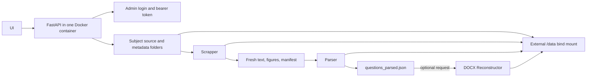

# Processing flow

An upload is stored unchanged under `<subject>/source/`. A processing request extracts into a temporary work folder, parses that new manifest, validates the structured JSON, then publishes Scrapper and Parser artifacts. Failed stages do not publish the temporary results. DOCX reconstruction is a separate request.

Each subject has `source/`, `output/Scrapper/`, `output/Parser/`, `output/Reconstruct/`, `manifests/`, `logs/`, and `metadata/`. A PDF's manifest stays with its Scrapper artifacts so its relative files remain easy to trace. SQLite admin and job records are persisted in that subject's `metadata/` folder. Docker mounts the configured host storage root at `/data`.

## Lite mode (`PARSER_MODE=llm`)

Lite mode skips the Scrapper stage entirely: page images are rendered in
memory, sent to NVIDIA Nemotron 3.5 Parse, classified by Nemotron Super VL in
batches, and assembled deterministically into `questions_parsed.json` written
directly under `output/Parser/<stem>/` (with extraction/classification caches,
a resume checkpoint, and cropped `assets/figures/`). There is no temporary
staging folder and no publish/rollback step; a validated partial bank is always
retained. See [docs/BACKEND_ARCHITECTURE.md §5](docs/BACKEND_ARCHITECTURE.md#5-active-parsing-pipeline--nvidia-lite-two-stage-parser_modelllm).

