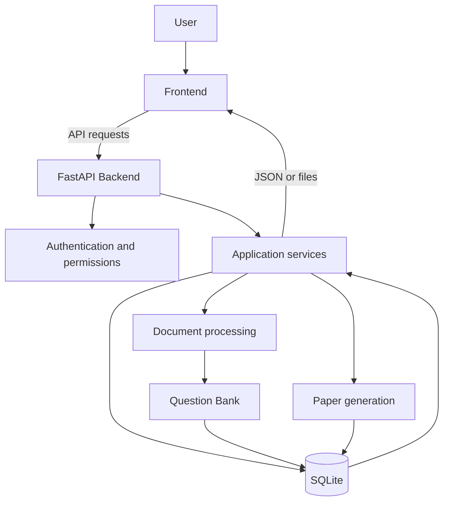
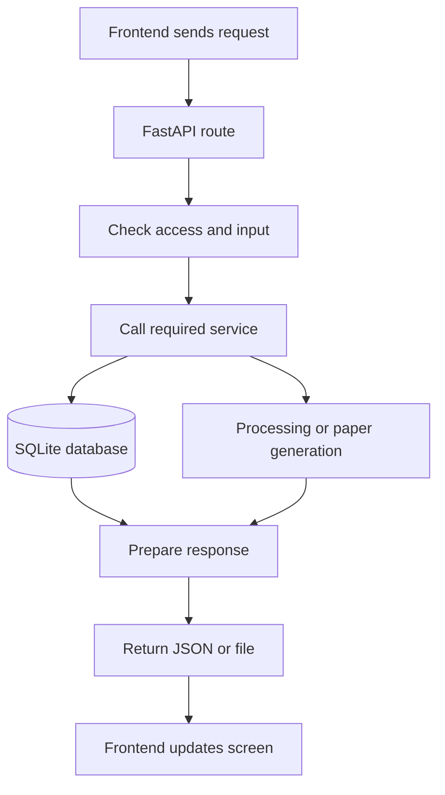
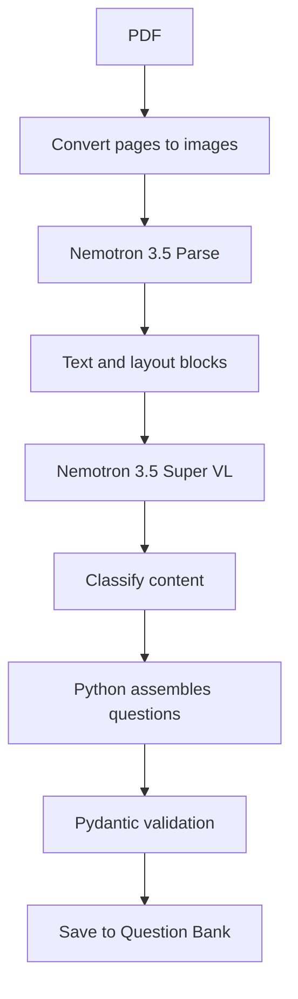
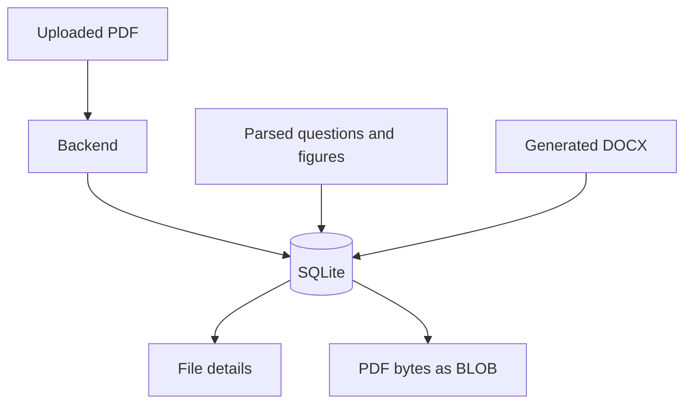
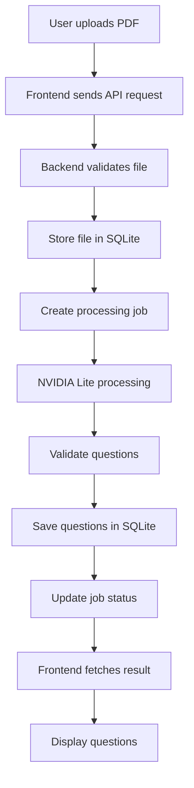
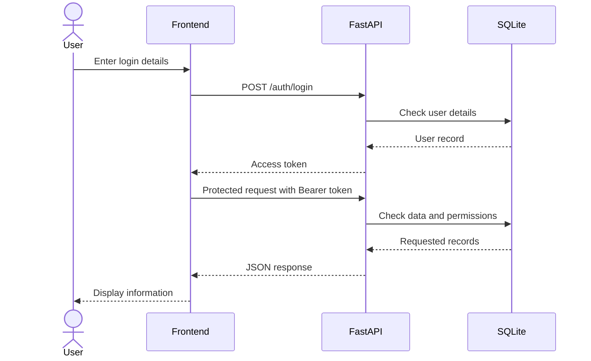
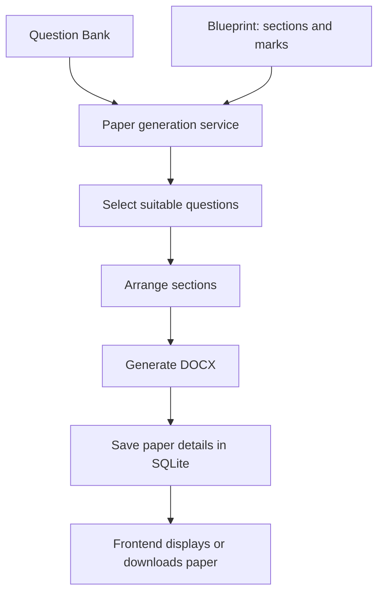

# MasterDeOrca — Project Overview

## 1. What the application does

MasterDeOrca turns uploaded question papers into an organised Question Bank. Users can review questions, set priorities, create paper blueprints and generate new question papers as DOCX files.

**In short:** Upload a paper → extract questions → organise them → generate a new paper.

## 2. Application architecture

The application has two main parts:

- **Frontend:** The screens, forms, buttons and tables.
- **Backend:** Handles requests, permissions, processing, database operations and paper generation.

The frontend communicates with the backend through APIs. The backend uses SQLite to store application data.



## 3. Frontend

The frontend is built with HTML, CSS and JavaScript. It lets users:

- Sign in and manage their account.
- Manage subjects and upload PDFs.
- Start processing and check job status.
- Review and manage questions.
- Set priorities and create blueprints.
- Generate and download question papers.

The frontend does not access SQLite directly. It sends API requests and displays the backend's responses.

## 4. Backend

The backend uses FastAPI. It:

- Checks login details and user permissions.
- Manages subjects, uploaded documents and processing jobs.
- Runs document processing.
- Stores and manages Question Bank records.
- Manages priorities, blueprints and drafts.
- Generates question papers.
- Tracks jobs and handles recovery of unfinished work.

A typical request follows this path:



## 5. QuesScrapper and QuesParser

The older Local pipeline has two separate parts.

### QuesScrapper — collects document content

It reads PDF pages, extracts available text, converts pages to images when needed and uses OCR for scanned documents.

**Technologies:**
- **PyMuPDF:** Reads PDF pages and extracts text.
- **PaddleOCR / PaddlePaddle GPU:** Reads text from scanned pages and images.
- **Python:** Connects the steps and prepares the extracted content.

### QuesParser — organises questions

It takes the collected content and identifies questions, sub-questions, marks, sections, instructions, figures and tables. It then creates structured question records.

**Technologies:**
- **LangGraph:** Organises parsing steps.
- **LangChain and model integrations:** Connects language models used by the Local parser.
- **Python:** Cleans and arranges the extracted content.
- **Pydantic:** Checks that the output follows the expected structure.

The Local parser can be configured with providers such as Gemini, Mistral, Groq, Cerebras or OpenAI. These are alternatives, not all required together.

**Difference:** Scrapper collects the content; Parser understands and organises it.

## 6. Parser versions

The project contains two processing paths.

### NVIDIA Lite — active path

Lite uses NVIDIA services through their APIs:

1. PDF pages are converted into images.
2. **Nemotron 3.5 Parse** extracts text and page layout.
3. **Nemotron 3.5 Super VL 120B A12B** helps classify and understand the extracted blocks.
4. Python assembles the questions.
5. Pydantic validates the question data.
6. The questions are saved to the Question Bank.



Lite uses NVIDIA's services over the network. It does not require the user's local GPU for model processing.

### Local — legacy path

The Local path uses QuesScrapper and QuesParser:

- PyMuPDF extracts PDF content.
- PaddleOCR can read scanned pages and may use the local GPU.
- LangGraph and configured language models organise the content.
- Python and Pydantic prepare and validate questions.

The Local code remains in the project, but NVIDIA Lite is the active processing path.

| Area | NVIDIA Lite | Local legacy |
|---|---|---|
| PDF reading | Nemotron 3.5 Parse | PyMuPDF |
| Content understanding | Nemotron 3.5 Super VL | LangGraph and configured model |
| OCR | Not part of the normal Lite path | Optional PaddleOCR |
| Local GPU | Not required for model processing | May be used for OCR |
| Current role | Active | Legacy code path |

## 7. SQLite and file storage

SQLite is the application's main and persistent database.

It stores:
- Users, roles and permissions.
- Subjects, uploaded documents and processing jobs.
- Parsed questions and Question Bank records.
- Priorities, blueprints and drafts.
- Generated-paper records, figures, logs and processing artifacts.

Uploaded PDFs, figures and generated DOCX files are stored as **BLOBs** in SQLite. A BLOB stores the actual file bytes. The database also stores file details such as name, type and related subject.

Temporary files may be created while processing if a library needs a file path. They are not the permanent storage location.

**JSON is a data format, not the main storage system.** APIs use JSON to exchange information, while SQLite remains the persistent source of truth.



## 8. Upload and processing flow



Processing runs as a job because reading a document can take time. The frontend can check the job's status and request the result when it is ready.

## 9. APIs: frontend and backend communication

An API lets the frontend request information or actions from the backend.

The local development API address is `http://localhost:8000`.

Examples of API routes:

| Action | API route |
|---|---|
| Sign in | `POST /auth/login` |
| Get current user | `GET /auth/me` |
| List subjects | `GET /subjects` |
| Upload a PDF | `POST /subjects/{subject}/pdfs` |
| Start processing | `POST /subjects/{subject}/pdfs/{filename}/process` |
| Check job status | `GET /jobs/{job_id}` |
| Get parsed result | `GET /subjects/{subject}/pdfs/{filename}/result` |
| List questions | `GET /api/question-bank` |
| Get one question | `GET /api/question-bank/{question_id}` |
| Update a question | `PATCH /api/question-bank/{question_id}` |
| List blueprints | `GET /blueprints` |
| Generate a paper | `POST /api/question-papers/generate` |

The frontend uses a shared API helper. Its API base address can be configured with `window.QPG_API_BASE`.

After login, the backend returns a JWT access token. The frontend keeps it in `sessionStorage` for the current browser session and sends it with protected requests.



## 10. Example JSON

JSON is a text format used to exchange structured information. These are simplified examples, not exact schemas for every API.

**Subject**

```json
{
  "subject_id": "operating-systems",
  "name": "Operating Systems",
  "status": "active"
}
```

**Question**

```json
{
  "question_id": "question-001",
  "subject_id": "operating-systems",
  "question_number": "Q1(a)",
  "text": "Explain process scheduling.",
  "marks": 5,
  "section": "Section A",
  "page_number": 2
}
```

**Processing job**

```json
{
  "job_id": "job-123",
  "filename": "question-paper.pdf",
  "status": "running",
  "message": "Document is being processed"
}
```

For example, the frontend can request questions with:

```http
GET /api/question-bank?subject_id=operating-systems&page=1&page_size=20
```

The backend reads the matching records from SQLite and returns JSON. The frontend uses the returned fields to display the questions.

## 11. Generating a question paper

The paper generation service uses questions from the Question Bank and the rules in a blueprint.



## 12. Security

- Users sign in before accessing protected features.
- The backend checks JWT tokens and permissions.
- Restricted actions require the correct role.
- Uploaded files are checked before processing.
- The frontend communicates with the backend instead of accessing the database directly.

## 13. Development phases

1. **Initial UI:** Created the screens, navigation, forms and basic user flow.
2. **Backend connection:** Connected the screens to API routes and displayed backend data.
3. **Final corrections:** Updated the screens and behaviour to match the agreed features.

## 14. Quick glossary

| Term | Meaning |
|---|---|
| Frontend | The screens users work with |
| Backend | Handles the application's work |
| API | Connects the frontend and backend |
| JSON | Format for exchanging structured data |
| SQLite | The application's database |
| BLOB | Stores file bytes inside the database |
| Scrapper | Collects text, pages and images |
| Parser | Organises content into questions |
| OCR | Reads text from images |
| Question Bank | Collection of organised questions |
| Blueprint | Rules for arranging a question paper |
| Job | Tracks a task that takes time |

## Final summary

The frontend provides the screens. FastAPI handles requests and application logic. NVIDIA Lite reads and organises uploaded question papers. SQLite stores the application's records and files. The Question Bank supplies questions for generating new DOCX papers.

**Frontend displays it. Backend handles it. Parser organises it. SQLite stores it. APIs connect everything.**
